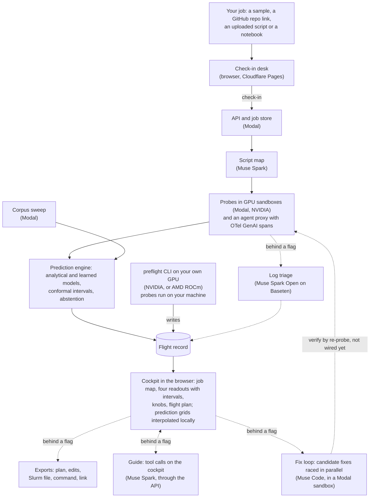

# Preflight

[](https://preflight-cqn.pages.dev/s/ICDYrfHQ2nBNbv3mlRHHMg)

**A flight simulator for ML jobs.** Preflight measures a few minutes of your real training,
evaluation, serving or agent job, builds a model of how it behaves, and lets you fly the whole
run, or a whole campaign of runs, before you spend real GPU hours or API dollars.

Everything in this repository was built during the Meta Global AI Developer Hackathon
(Oct 26 to Nov 4, 2026). The first commit is `11a0ce9`, Oct 26, 22:25 ET; nothing was carried
over from earlier work.

## Status

As of Sun Nov 1 (round five). Every feature ships behind a flag that is off until its check
passes (`flags.json`); `flags.production.json` turns on what the public site runs. The public site
is live at <https://preflight-cqn.pages.dev>.

**On in production**

| What | Where it shows | Source |
| --- | --- | --- |
| Muse Spark reads each script (the script map) | Boarding's "Reading your script", and the cockpit's job map | `harness.spark_script_map`, on in `flags.production.json` (Chiya, Nov 1) |
| Predictions with intervals and abstention: memory, step time, cost, risk | The cockpit's four readouts, the knobs and the flight plan | `engine.memory`, on in production (Chiya, Oct 30); it gates the whole prediction step (`runner/pipeline.py`) |
| Campaign calendar | The campaign sample (illustrative numbers, B's planner on a 12-run grid) | `c.campaign_calendar`, on in production (Chiya, Nov 1) |
| Checking in your own repo or script | New flight's Repo link and Upload tabs: Preflight runs a few probe steps of your job on a rented GPU, sandboxed, and opens the record in the cockpit and a Notebook tab for a Jupyter notebook (`d.notebook`, on in production since Nov 2: a training notebook checked in end to end, A's `a-notebook-checkin-3`) | `runner.queue`, on in production (Chiya, Nov 1). Demo limits: 3 probe jobs per visitor per day, and a daily GPU spend cap for the whole site (US$10 a day through Nov 4) [cited: `python/preflight/runner/queue.py`]. Past either, the site opens samples and shared records only until midnight ET |
| The guide (Muse Spark moves the knobs with tool calls) | The cockpit's guide panel | `c.guide.live`, on in production (Chiya, Nov 1). Smoke runs pass: GitHub run 41273350602, 5 rounds, all called tools [measured], US$0.019 [derived: reported tokens at list prices]. Its spend limits: US$0.40 a tour [derived], and US$10 a day for the whole site [guess: the code's value, pending Chiya's answer], with round limits per visitor and per address (`api/preflight_api/ledger.py`). If the live guide fails before it answers, the rule-based tour starts in its place (`web/src/guide/GuidePanel.tsx`) |
| Fit map: which settings fit, with the out-of-memory frontier | The cockpit's Fit view: drag your run across the map | `c.fit_map`, on in production (Chiya, Nov 1) |
| RL readouts: the share of prompt groups with no reward spread, rollout time | The GRPO lens | `engine.rl`, on in production (Chiya, Nov 1); calibrated on A's GRPO runs (L4 smoke runs and a 50-step run on an A10) |
| Log triage by Muse Spark Open on Baseten | A probe that fails gets a finding quoting its log line, labelled "Found by Muse Spark Open triage" | `harness.spark_open_triage`, on in production with its data-use line (Chiya, Nov 1) |
| GRPO lens on a measured run | The GRPO sample: reward spread, completion lengths, the tour | A's L4 run `a-gt-grpo-l4-3`; no flag |
| Cost readout at your own rate | Every dollar readout: quantity x rate = total, with the price table's source and date | No flag |
| Verify a fix in your own CI | A GitHub Action (below) | No flag; usable from other repositories once this one is public |
| Possible outcomes (HOPs) and exports: the plan, an edit script, a Slurm batch file, the run command and a W&B script | The cockpit's "Possible outcomes" toggle, and the exports band under the whole run | `c.hops` and `c.exports`, on in production (Chiya, Nov 1, 8 PM); checked by C on all 10 samples on a production build |
| The add-ons: detail level, costs in your currency, free GPUs | The Logbook and the cockpit (below) | `d.expertise`, `d.currency`, `d.freetier`, on in production (Chiya, Nov 1, 8 PM); checked by D in Chromium, desktop and phone |
| The fix loop: Muse Code writes candidate fixes, Preflight's re-probe picks the winner | A finding's "Fix it" in the cockpit | `c.fix_loop`, on in production (Nov 2). On the LoRA sample's eval OOM, Muse Code's single fix was correctly rejected by verify (the eval still ran out of memory); the stacked fix at the guide's eval batch 8 passed: eval peak 10.4 GiB, loss within 0.11% [measured: C's race, US$0.39] |
| In-flight mode: watch a real run against its predicted bands | Logbook, "Watch a real run": open the live record that `preflight watch` writes on your machine; nothing is uploaded | `c.inflight`, on in production (Nov 2). On an A10 matching its probes the step band held over 159 steps with no false alert; on an A10G the run was 11% slower and the alerts fired [measured: B's runs b-inflight-a10-lora-3 and -2] |
| Clearer failed check-ins: a job stops paying for points that can't import, an agent script's last error line is kept, and samples never send their own measured answers | Boarding and the record | `runner.stop_on_import_error`, `probes.agent_error_line`, `runner.hide_sample_outputs`, on in production (Nov 2) |
| Muse Spark diagnosis: one call per finished record reads its memory timeline and loss plot with the raw probe numbers and reports where they disagree, each claim checked against the numbers | The record's Findings, "Found by Muse Spark diagnosis" | `harness.spark_diagnosis`, on in production (Nov 2, with the claim check). No call when no plot has anything drawn; a record a private check-in touched is never diagnosed |
| Settings between the grids' cells: where a grid holds no value, the cockpit asks the engine (CPU only, no model) and shows its estimate with its own status | Dials, timeline and guide readouts | `c.engine_fallback`, on in production (Nov 2). On the LoRA record, lr 2e-4 reads 1.709 s a step predicted, and the A10 1.236 s extrapolated, where it read "off grid" [measured: C's API test] |
| Bring your own script: installs the repo's declared dependencies (pyproject.toml, setup.py) when there's no requirements.txt, extra packages on request, a big repo read from its entry point, an evaluation run by command (`lm_eval ...`), and one free resend a day after a check-in that stopped before measuring anything | New flight and Boarding | `probes.repo_install`, `probes.extra_hosts`, `c.checkin_help`, `runner.command_checkin`, `probes.eval_units`, `runner.free_resend`, on in production (Nov 3). On the nine unseen scripts after the freeze, with fixes designed on them: 3 of 9 reach their first step with the install fixes, and lm-evaluation-harness by command measures, its probe's peak equal to the full run's [measured: A's ops runs]. The first attempts stay 0 of 9 |
| The `preflight` CLI (`map`, `run`) | Your own machine | On `main`; the `pip install git+...` line works once the repository is public |

**Behind a flag, off for now**

| What | Flag | Where it stands |
| --- | --- | --- |
| The CLI re-check item in the exports | `d.exports_cli` | Built on `main`; on once the repository is public (Nov 3 to 4) |

**Not used, or not measured**

| What | Why | Source |
| --- | --- | --- |
| Divergence classifier | Still misses after a refit on 720 runs, held out by settings family: AUROC 0.66 (0.56 to 0.76) against a 0.85 target, with a lead of 138 steps (3 to 269) [measured: B's fit report], so `risk.divergence` stays off and is not used; the warning comes from the threshold rules | B's fit report, [`divergence_nov1.json`](python/preflight/corpus/reports/divergence_nov1.json) (`1cfa689`) |
| GBDT correction for an unmeasured GPU | Ties the analytical model held out on five GPU types (57%, 56% to 59%, against K1's 57%, 56% to 58% [measured, corpus, Nov 1]) and is worst on the H100 (42%), so it isn't used | `docs/decisions/calibration-l4-phase1.md` |
| Step time on an unmeasured GPU | Used, with its range, but 57% (56% to 58%) of held-out queries land within 20% over five GPU types and 6,694 config pairs [measured, corpus, Nov 1], under the 90% target; the H100, never scored before Nov 1, lands at 52%, and the T4 lowest at 51%. The range is honest about that: it covers 90% of held-out pairs, and for an H100 with no probe it runs from about 0.5x to 1.9x the replayed step | `docs/decisions/calibration-l4-phase1.md` (leave-one-GPU-out on the corpus) |
| Serving model | Built, switched off (`engine.serving`) until its validation row passes | `python/preflight/engine/api.py` |
| Muse Glimmer | Apache 2.0. B hosts it on Preflight's own GPU (an A100-40GB on Modal) for a private mode, `harness.glimmer_private`, on in production since Nov 2: a private check-in's probe logs are triaged by Glimmer and never sent to Baseten. It agreed with Spark Open's triage category on 9 of 11 failed probes (82%, Wilson 95% 52% to 95%) [measured: A's a-triage-agreement]; the first triage after a quiet spell waits 5 to 8 minutes for Glimmer to start | `docs/decisions/glimmer-host.md` |
| Full-run validation | Scored on Mon Nov 2 (the table below) | B's scorer |

## Try it

**In the browser, no install:** open <https://preflight-cqn.pages.dev>. Pick a sample to open it straight in
the cockpit (samples use illustrative numbers unless they say measured, and cost nothing), or open
a shared record's link. Or check in your own repo or script under New flight.

**Share a flight:** post
`https://preflight-cqn.pages.dev/s/<share token>`. Link previews show the record's headline numbers, each with
its status word (Measured, Predicted, Extrapolated, Not trusted or Illustrative), as text, with a
card image for the records whose card is pre-rendered, and the link opens the flight in the
cockpit.
For a README badge:
`[](https://preflight-cqn.pages.dev/s/<share token>)`
(`workers/README.md`).

**On your own machine, one command** (Python 3.11 or 3.12, in the environment that has your
torch):

```bash
pip install git+https://github.com/uchuuronin/preflight
```

**Quickstart:**

```bash
# 1. Read the script without running it (seconds): lens, framework, knobs and where the code sets them.
preflight map train.py

# 2. Measure a few steps on this machine (its GPU if it has one) and write a flight record.
#    On a real script this takes a few minutes: probes run real training steps.
preflight run . --entrypoint train.py --out .preflight/records

# Arguments for your script go after --, e.g.
preflight run . --entrypoint train.py -- --batch_size 16
```

The record lands in `.preflight/records/<share_token>.json`, a JSON flight record. Opening a local
record in the web app isn't built yet: the app opens records by their share link.
(Checked Oct 31 by D: the package installed from this checkout in a fresh Python 3.11
environment with torch 2.5.1 ran three probes of a small torch loop on the CPU and wrote a record;
the GitHub install line itself can be tried once the repository is public.)

## How it works

GPU time goes to a few minutes of probes, a background corpus sweep and verify runs; everything a
visitor explores afterwards is computed in the browser from the flight record.



The shared interfaces (flight record, prediction API, job events, UI extension points) and who
owns which path are in [CONTRACT.md](CONTRACT.md).

## Meta models and partner tools

| Tool | Where it is used | Status on `main` `a52753f` |
| --- | --- | --- |
| **Muse Spark** (`muse-spark-1.3`, Meta Model API) | Maps each script with structured output (`python/preflight/harness/`); runs the guide through the Responses API with tool calls on the live cockpit (`api/preflight_api/guide/`); the model behind the agent bug-zoo script (`zoo/agent_eval_spark/`) | Script map on in production (Oct 28 runs, before the flag: US$0.0178 and US$0.0200 a job [derived: reported tokens at list prices]); guide behind `c.guide.live` |
| **Muse Code** (headless) | Fix loop: candidate fixes raced in parallel worktrees inside a sandbox, edits only; the API key reaches Muse Code on stdin only, never in its environment or files; each fix is gated on Preflight's own re-probe and verify, not on Muse Code's exit code (`api/preflight_api/fix/`) | `c.fix_loop`, on in production (Nov 2): every fix is verified by a re-run on Preflight's runner with a fixed-seed loss check; on the LoRA sample's eval OOM the single fix was rejected and the stacked fix passed (eval peak 10.4 GiB, loss within 0.11%) [measured: C's race, US$0.39] |
| **Muse Spark Open** (Baseten) | Triage: reads each probe's log tail and names the cause, quoting the line it read; code checks the quote is really in the log (`python/preflight/harness/triage.py`) | Triage on in production (`harness.spark_open_triage`, Nov 1). The claim check (`harness/claim_check.py`, `harness.spark_claim_check`, on in production Nov 2): every number in a model-written finding is checked against the record's raw probe numbers, and Spark Open only picks among fields the code found; on planted claims true numbers passed 101 of 107 (94%, Wilson 88% to 98%) and altered ones were caught 93 of 102 (91%, 84% to 96%) [measured: B's b-claim-check-eval, US$0.36]; capped at US$0.10 a job, and a record a private check-in touched is checked by code only |
| **Muse Glimmer** | Private mode's triage on Preflight's own GPU, and one of three models in the agent model sweep's price table | `harness.glimmer_private`, on in production (Nov 2); hosted by B on Modal (`docs/decisions/glimmer-host.md`) |
| **Modal** | Probes in GPU sandboxes, the job store and API, the background corpus sweep, the fix loop's sandboxes | Every measured run so far (Oct 28 to Nov 1, `docs/status/a.md`); the runner (job store), the API and the fix app are deployed in production and stay up since Nov 1 |
| **AMD Developer Cloud** | ROCm probes through the CLI on an MI300X, and the AMD half of the corpus (`python/preflight/corpus/`, `.github/workflows/amd-run.yml`) | The AMD Developer Cloud account stayed on a verification hold, so the AMD runs used a rented MI300X (RunPod, ROCm 6.4.4, torch 2.5.1+rocm6.2) through `amd-run.yml` on Nov 2: the LoRA and nanoGPT zoo scripts' records and bare runs (records `a-amd-*` on the `remote-runs` branch). LoRA's eval pass, which runs out of memory on the L4 and A10, peaks at 137.7 GB and fits on 192 GB [measured]; B's scored AMD rows go in the validation table |
| **Cloudflare Pages** | The web app, the `/v1` edge function that forwards to the API with a shared secret and the visitor's address for quotas (`web/functions/`), and share cards (`workers/`) | Live at <https://preflight-cqn.pages.dev>, with share pages and cards (`/s/<share token>`) |

## What a run costs to measure

One run so far (A, Oct 28, job `a-smoke-l4-main-4`, the LoRA fine-tune zoo script): upload to
flight record in 6 min 45 s [measured], with 386 s of probe time on one L4 [measured]; that is
over the plan's 5-minute target. GPU $0.0858 [derived: measured probe time at the L4 list rate]
and Muse Spark $0.0178 [derived: reported tokens at list prices]. The sandbox's CPU and memory
are not in that total yet; Modal's bill replaces the estimate.
TODO(PM): replace with the validation table's "Cost of one Preflight run" row once scored.

## The corpus published with a datasheet

The measurements behind Preflight's learned models and its held-out checks are published as a
dataset: [huggingface.co/datasets/chaoschia/preflight-corpus](https://huggingface.co/datasets/chaoschia/preflight-corpus) (Hugging Face commit `0aac218`). It holds
`preflight-corpus-0.3.0.jsonl.gz` (corpus@0.3.0: 2,339 rows, 1,519 kernel configs, 100 Hugging
Face jobs and 720 divergence runs [cited: the datasheet]), `SHA256SUMS` and a dataset card. The
datasheet, after *Datasheets for Datasets*, says how it was made, what it covers and where it is
biased: [`python/preflight/corpus/DATASHEET.md`](python/preflight/corpus/DATASHEET.md). The
measurements are Apache 2.0, like the repository. **The dataset is private until it goes public
with the repository on Nov 3 to 4.**

## Validation

Predictions are checked against real full runs, hit or miss, starting with the runs scored on
Mon Nov 2. The table between the markers below scores each validation target and says so when a
row has nothing to score yet. It is written by
`scripts/score_validation.py <manifest.json> --readme README.md` from one manifest of full runs;
edit the manifest, not the table. The knob response row's timings
come from a stranger test run at 4x CPU slowdown (`KNOB_MS_OUT=out/knob_ms.json node
web/e2e/stranger.mjs`), copied into the manifest's `knob_ms` list.

<!-- validation:start -->
| Metric | Target | Measured on | Result | 95% interval | Hit | Status | Notes |
|---|---|---|---|---|---|---|---|
| Peak memory error | Within 10% | Bug zoo and unseen scripts, full runs | not measured |  |  | not yet run | no full run scored yet |
| OOM prediction | No missed OOMs; at most 1 false alarm per 10 scripts | Bug zoo and unseen scripts | 1 of 1 | 20% to 100% | hit, few runs | measured | missed: none; false alarms: none; reliability: 95%-100%: 1 of 1 ran out |
| Step time, same GPU | Within 15% | Full runs | not measured |  |  | not yet run | no full run scored yet |
| Step time, unmeasured GPU | Within 20% | Train on 4 GPU types, test on the 5th; NVIDIA GPUs (NVIDIA to MI300X is scored apart, below: 22% within 20% (NVIDIA torch 2.8.0 to MI300X torch 2.5.1+rocm6.2: card and software differ)) | 3826 of 6694 | 55% to 59% | miss | simulated | K1 roofline, 6694 config pairs over A10, H100-SXM-80GB, L4, L40S, T4; lowest held out: T4, 232 of 454 |
| GNN + GBDT ensemble vs GBDT alone | Lower error on held-out architectures | Corpus holdout |  |  | miss | simulated | paired gain +4.8% (95% -1.4% to +11.6%); the interval includes zero, so the GBDT is used |
| Divergence warning | AUROC 0.85+, 100+ steps early | Held-out short runs | 720 runs |  | miss | simulated | AUROC 0.66 (0.56 to 0.76); warns 138 steps early (3 to 269); bootstrap over settings families (the sweep is one architecture); 44 of 720 runs diverged; not used: the warning comes from the threshold rules (D6): 37 of the 44 divergences are fp16 blow-ups and 15 of 44 come in the first 30 steps, before the classifier's 25-step window can say much; held-out AUROC 0.66 against the 0.85 target; median lead 138 steps (95% 3 to 269): the point estimate clears 100, the interval doesn't |
| Rollout time (RL) | Within 20% | An unseen TRL script (the GRPO zoo script calibrated it, Nov 1) | not measured |  |  | not yet run | no full run scored yet |
| Serving tokens/sec | Within 15% | vLLM full runs | not measured |  |  | not yet run | no full run scored yet |
| Agent run total cost | Inside the 90% interval | Full benchmark run vs the 30-task sample | 1 of 1 | 20% to 100% | hit, few runs | measured | agent_eval_spark: predicted $7.15 (90% $5.90 to $13.71), the full run cost $6.66 |
| Interval coverage | 90% intervals cover at least 88% | All of the above | 1 of 1 | 20% to 100% | hit, few runs | measured |  |
| Abstention | Every query outside the probed range is flagged | Automated test | checked on every CI run |  |  | test suite | tests/test_engine_api.py, run with the suite |
| Planted problems caught | All of them | Bug zoo | 3 of 3 | 43% to 100% | hit, few runs | measured |  |
| Unseen scripts harnessed | 8 of 9 without hand edits | One per job type | 0 of 6 | 0% to 40% | miss | measured |  |
| Knob response | Under 400 ms at p95 | Browser timing | 9 of 9 | 70% to 100% | hit, few runs | measured | p95 198 ms; stranger test: build main cfcf83c, vite preview, base http://127.0.0.1:4173, cpu slowdown 4x, measured at 2026-11-02T05:28:36.930Z |
| Cost of one Preflight run | Under $1 and under 5 minutes | Modal billing and timer | not measured |  |  | not yet run | no Preflight run's cost and time given |
A "within" target is a hit when at least 90% of runs are within it; intervals are Wilson 95% on the proportion, and a hit is "confident" only when its lower end is at least 90% ("hit, few runs" otherwise). Status: "measured" is scored against what real runs did; "simulated" is the engine replaying held-out corpus measurements it never saw, with no full run launched; "not yet run" waits for Monday's runs; "test suite" is checked by the automated tests on every CI run. Unseen scripts are never tuned on. Scored 2026-11-02 16:54 UTC from manifest_unseen_nov2.json: 8 runs scored; not measured yet: unseen-1, unseen-5, unseen-6 (3); 8 of the 9 with records held out of at least one row. Used for calibration, so not held out: finetune_lora_hf (step, intervals); grpo_trl (every row). Engine flags on (flags.json with flags.production.json): engine.rl, engine.steptime_cross_gpu. Models: agent-bootstrap-cp@0.1.0, agent-context-fill@0.1.0, agent-time-concurrency@0.1.0, cost-gpu-hours@0.1.0, input-check@0.1.0, memory-analytical@0.3.1, rl-rollout-bootstrap@0.1.0, rl-zero-spread@0.1.0, steptime-phases@0.2.0, time-total@0.1.0, calibration table 50ea0fb14a.
<!-- validation:end -->

### How these numbers were made

- **Frozen engine.** Every unseen script is predicted by the engine, harness and runner as of commit `56c2141` (branch `freeze/validation`, declared Nov 2 2026 at 06:42 ET, before any agent opened the unseen list), with calibration table `50ea0fb14a`. The table is scored from a separate checkout of that commit, so the frozen commit is what every row measures; fixes made afterwards are scored apart, as below.
- **The list was fixed first.** The SHA-256 of the unseen-scripts list was committed on Nov 1 at 01:46 EDT, before the clocks went back that night (`4ca3704`, `docs/validation/unseen-hash.txt`), before any validation run. The list contains a random salt, so the hash can't be matched by guessing. It was published on Nov 2 as `docs/validation/unseen-scripts.md`, and `uv run python scripts/check_unseen_hash.py docs/validation/unseen-scripts.md` matches it to that hash.
- **First attempts only.** Each row counts each script's first attempt on the frozen commit. If a script needed a fix to run, or a bug the runs found was fixed after the freeze, the later result is reported separately as "after freeze" and never changes these rows. Zoo runs that were used to calibrate a model (named in the stamp under the table) are left out of the rows they calibrated.
- **The hit rule.** A "within X%" row is a hit when at least 90% of the runs land within it. A hit is "confident" only when the lower end of its Wilson 95% interval is at least 90%; otherwise it reads "hit, few runs". The agent-cost row needs every full run inside the sample's 90% interval, and interval coverage needs at least 88% of the scored values inside their 90% intervals.
- **Wilson intervals.** Every hit count carries a Wilson 95% interval on the proportion, rounded outwards (the lower end down, the upper end up), so a small sample never reads better than it is.
- **Status.** "measured" is scored against what real runs did; "simulated" is the engine replaying held-out corpus measurements it never saw, with no full run launched; "not yet run" has nothing to score yet; "test suite" is checked by the automated tests on every CI run.

### The unseen scripts, first attempts (Nov 2)

Nine public scripts, one per job type, picked and hashed before the runs, each run once as a visitor would send it, on the frozen commit `56c2141` (A's status file, "Unseen validation runs (Nov 2)", has each run). The table above is the frozen scorer's output on those first attempts with the zoo runs we already had. In plain words:

- **Hit:** OOM prediction (1 of 1: the zoo LoRA run's eval OOM, predicted at 100%), agent run total cost (1 of 1: the 500-task MBPP run's $6.66 inside the 30-task sample's $5.90 to $13.71), planted problems caught (3 of 3), knob response (9 of 9 under 400 ms, p95 198 ms), interval coverage (1 of 1). All of these are **"hit, few runs"**: one to nine runs each, so none is a confident hit.
- **Missed:**
  - **Unseen scripts harnessed: 0 of 9 without hand edits** (Wilson 95% 0% to 30%), against a target of 8 of 9. Three were refused before any probe (lm-evaluation-harness and vLLM as larger than Preflight reads; torchtune as too much Python to map), two stopped at an import the probe image lacks (open_r1's src/ layout, torchvision), and four never reached a probe: 2, 7 and 8 got no L4 in 20 minutes, and 4 was read as a serving job and waited for one too. Their retries, scored apart, stopped at missing imports (lightning, smolagents, sentence_transformers, torch_geometric). None ships a requirements.txt. The scorer's row reads 0 of 6, because it counts only scripts that produced a record; the three refused before a record existed are misses too (a scorer gap these runs found, logged for after scoring).
  - **Step time on a GPU the corpus never ran:** 57% within 20% (55% to 59%), against 90%. Simulated on held-out corpus pairs.
  - **Divergence warning:** AUROC 0.66 (0.56 to 0.76), against 0.85. Simulated on held-out short runs; not used in the product.
  - **GNN + GBDT vs GBDT alone:** the paired gain's interval includes zero, so the GBDT alone is used. Simulated.
- **Not measured:** peak memory, same-GPU step time, rollout time, serving throughput and the cost of one Preflight run. **No unseen full run reached its first step**: each stopped at a missing import (torchao, lightning, open_r1, smolagents, sentence_transformers, torch_geometric, torchvision) or was refused, and 4a's agent sample exited after 2 seconds with no task, so there is no measured peak memory, step time or out-of-memory to score them against. The zoo full runs we have were used to calibrate these rows, so they don't score them either.

What happens next is scored apart, as "after freeze": A has built `probes.repo_install` (off), which installs a repo's declared dependencies and known imports when it has no requirements.txt; the nine are re-run with it after the runner is redeployed, and those results never change the rows above.

### After the freeze (Nov 2)

Changes made after the freeze, scored apart. They never change the table above.

- **Divergence warning, refit, not shipped** (`scripts/fit_divergence_v2.py`, report `python/preflight/corpus/reports/divergence_v2_nov2.json`): a prior from the run's settings, known before the first step, beside the Nov 1 step model. Scored once on the same 720 held-out sweep runs, folds, warning line and bootstrap as the row above, it reads AUROC 0.97 (95% 0.94 to 0.99) and a median lead of 162 steps (27 to 293), and all 15 early blow-ups raise an alarm. **That number measures how the sweep was drawn, not a warning a real run would get.** The sweep drew learning rates from 1e-4 to 0.48; every one of its 44 divergences came at 0.07 or more, the learning rate alone ranks the runs at AUROC 0.92 on the same folds, and none of the 465 runs at 0.03 or below diverged. A warning can't be checked where people actually train from this sweep, so it isn't shipped: `engine.divergence` stays off, and the threshold rules (D6) give the warning. What it needs is a sweep with divergences at usual learning rates (fp16 overflow, bad init, no warmup at lr 3e-4 to 3e-3). This is also the second fit on these 720 runs, with the interactions chosen after seeing the first fit's misses.
- **The nine unseen scripts, re-run after the freeze** (A's ops full runs with `probes.repo_install` on in each run's own process; production keeps it off; table `docs/validation/table-after-freeze-nov2.md`, frozen scorer). **Harnessed: still 0 of 9.** After the freeze, 1 of 9 reached its own work in A's ops full runs: BEIR (7), which ran out of memory on the A10 before its first step (21.5 GiB reserved on a 22 GiB card). That is neither production nor a Preflight check-in yet. The rest stop before a step: a torch newer than the image's (1); open-r1's own environment, TRL 0.18 and vLLM with a dependency list built in code (3); torch_sparse with no PyPI wheels (8); the install time (2, re-running); the vLLM image (4b, the lens misread fixed on ws-b); the `openai` extra missing, then a failed first generation, so the smolagents agent sample ran no task to the end (4a); CIFAR-10 downloading at about 35 kB/s, 27% of 170 MB when the run's 22.5-minute limit ended it (9, `a-after-9-gt`, GitHub run 41491655356); 5 and 6 are still refused as too large. **OOM prediction: 1 of 2 (Wilson 95% 9% to 91%), a miss:** the zoo LoRA eval OOM is caught, BEIR's is not, because Preflight's only record of BEIR is its first attempt, which never got a GPU and so abstains.
- **Preflight vs asking a model, after the freeze: it rests on 2 runs**, and one of them is the zoo LoRA run already in the first comparison. Both caught the LoRA OOM; both missed BEIR's: Preflight abstained (no probe), and Muse Spark gave it a 15% chance (14 GiB, 90% 10 to 19). 1 of 2 each (9% to 91%): it still can't say which is more accurate (`docs/validation/preflight-vs-model.md`).
- **The zoo scripts' full runs** (B, Nov 2 evening; table `docs/validation/table-zoo-after-freeze-nov2.md`, frozen scorer; each full run on Modal's "A10", against a check-in on the "A10": the full runs of gnn and retrieval got an A10, vision and nanoGPT an A10G, about 11% slower on the LoRA script; the check-ins' card isn't recorded). Per script, predicted against the full run:

  | Script | Peak memory, predicted (90%) | Full run | Step, predicted | Full run |
  |---|---|---|---|---|
  | gnn_pyg (471 steps, finished; A10) | 5.2 GB (4.6 to 6.0) | 8.5 GB | 0.056 s | 0.061 s |
  | retrieval_st (12,279 steps and the recall pass, finished; A10) | 1.0 GB (0.9 to 1.2) | 2.4 GB | 0.038 s | 0.031 s |
  | vision_timm (80 steps, finished; A10G) | 4.0 GB (3.5 to 4.5) | 3.6 GB | 0.125 s | 0.150 s |
  | pretrain_nanogpt (300 of its steps; fixed shapes; A10G) | 20.6 GB (18.5 to 22.9) | 20.3 GB | 0.955 s | 0.705 s |

  **Peak memory: 2 of 4 scripts within 10% (vision, nanoGPT); both misses run low.** gnn's allocated peak is 2.6 GB in the probe, at step 300 and at the end alike; only the allocator's reserved pool grows (4.7, 6.6, then 8.5 GB), likely fragmentation from the varying subgraph sizes [guess]. Retrieval's allocated peak rises from 0.6 to 1.3 GB, likely in the final recall pass over 100,000 answers, after the training the probes see [inferred: the script's last phase; no per-phase memory was measured]. Every memory number here is the analytical model's extrapolation, on either card. **Same-GPU step time: 1 of 4 within 15% (gnn)**; nanoGPT's check-in probe read 0.955 s a step where the ground truth's own 35-step recorder probe read 0.735 s and the full run 0.705 s, so the check-in probe likely landed on another card or a busier box [guess]. **OOM: 6 scripts, 2 ran out; the LoRA eval OOM caught, BEIR's missed** (no probe), no false alarm. **Planted problems: 6 of 7** (vision's no-channels-last missed; the eval sweep's `eval.activation_dump` caught). The miss is fixed on ws-b after the freeze: the zoo script's own header names the finding ("vision.no_channels_last"), which hid it from the static reader, and Muse Spark's map writes "channels-last", which the rule didn't match; both now read it (`tests/test_static_lens_repos.py`), so a new check-in of the sample raises it, while the stored record keeps the miss. **Moved GPU** (the samples' L4 records against the same full runs): memory 0 of 3. gnn and retrieval miss on the same GPU too; vision flips, because moving the GPU swaps the probe's measured CUDA context (about 0.27 GB) for a guessed 0.81 GB (retrieval: 0.98 GB predicted on its own L4 becomes 1.52 GB for the A10, where the A10 record says 1.04 GB). An engine finding, logged. Not scored: the eval sweep and the vLLM server ran past 15 minutes (the server had 101 of its 1,024 prompts done, preempting as planted, at about 500 output tokens a second; Preflight's record put its P(OOM) at 99.9% and it hadn't run out), and torchtitan, which the probe image doesn't have (it needs torchtitan's own torch 2.7 stack; not added for Nov 4). Cost: about $1.65 of the $5 [estimate: nine ground truths, about 63 A10 minutes with start-up at $1.10/h, and seven check-ins at about $0.07 each, five of which gave a record].
- **LC-PFN on per-x means, re-run** (Chiya's review, Nov 2; run `b-lcpfn-binned`, CPU, about $0.01; report `python/preflight/corpus/reports/loss_coverage_binned_nov2.json`). The seen losses now go in as one mean per x of the prior (six steps to an x on these 600-step runs) instead of raw steps. **It made coverage worse, not better:** seen 60 steps, 618 of 676 (91%, Wilson 89% to 93%) against 627 (93%) on the raw steps; seen 150, 451 of 676 (67%, 63% to 70%) against 499 (74%). The ensemble covers 92% at 60 and 87% at 150 of the curves it answers. So LC-PFN still isn't wired and no loss readout ships. The power law already takes its band from a block bootstrap of the residuals (10-step blocks, 200 draws): that is the band that covers 24% and 23% (unchanged here), so the bootstrap isn't what it lacks.
- **The AMD rows** (Nov 2 evening; A's probes on a rented MI300X, ROCm 6.4.4, from main; table `docs/validation/table-amd-nov2.md`, frozen scorer; record and full run on the same card). **The zoo LoRA's rows: loss NaN on this stack (bf16, rocm6.2), timing and memory only** (the PM, from every AMD LoRA log: loss 0.0 and grad norm NaN after a first loss of 430, bf16 on torch 2.5.1+rocm6.2 on a ROCm 6.4.4 host; the same graph and kernels run, so step time and memory are real, but it isn't training). nanoGPT trains normally there (fp32, loss 10.98 falling to 9.30), so its rows are normal runs. **OOM: 2 of 2, and the one that ran out was caught.** The zoo LoRA's record put P(OOM) at 98.7% on the 206 GB card for its eval pass (its probe ran 2 of the eval's 33 batches and fitted at 137.7 GB, but the planted callback keeps every graph, about 64 GB more a batch); the full run to step 210 (`b-amd-lora-gt-eval`) ran out of memory at the first eval, step 200 ("HIP out of memory ... 178 GiB allocated by PyTorch"; 199.3 GB, 185.6 GiB, reserved at its peak, of the 206 GB, 192 GiB, card). A's earlier 120-step run stopped before that eval and showed only training. nanoGPT: P(OOM) 0.2%, no OOM. **Same-GPU step time: 2 of 2 within 15%**: the LoRA predicted 0.691 s (90% 0.562 to 0.850) against 0.696 s over its 200 steps; nanoGPT 0.254 s (0.173 to 0.373) against 0.262 s over 300. **Peak memory: nanoGPT 21.1 GB (18.9 to 23.4) against 20.3 GB, within 4%** (the LoRA's run ran out, so it never showed its full need, and isn't scored). **Across vendors, unprobed:** the product abstains for an MI300X from NVIDIA probes, and the corpus slice below says why. The K1 roofline underneath, run without that guard, puts the LoRA at 0.539 s (0.363 to 0.799) from its L4 record, 21% under the measured 0.681 s of A's run and inside its band, and 0.395 s (0.266 to 0.586) from its A10 record, 42% under and outside; nanoGPT abstains even then. So neither NVIDIA source lands within 20%: the L4 record comes closest, 21% under and inside its band.
- **The MI300X corpus slice: NVIDIA to MI300X step time misses** (Nov 2 night; `b-amd-grouped`, GitHub 41554116831, on the same rented MI300X: the 300 grouped configs of `corpus/data/amd_grouped.jsonl`, 295 distinct, all ok, torch 2.5.1+rocm6.2; scored once against the NVIDIA corpus rows of the same configs, torch 2.8.0, paired on the config since the key holds the torch version; no refit; `corpus/reports/amd_cross_nov2.json`). **K1 from an NVIDIA row lands within 20% of the MI300X's measured step on 254 of 1,147 pairs: 22% within 20% (NVIDIA torch 2.8.0 to MI300X torch 2.5.1+rocm6.2: card and software differ) (Wilson 95% 20% to 25%; 16% to 29% resampling the 59 config groups, since pairs share configs)**, against the 90% the row asks. **The cross-vendor band (sigma 0.22 in log space; its 90% band is x/÷1.44, about -30% to +44%) covers 411 of 1,147, 36% (Wilson 33% to 39%; 28% to 44% by config group), not 90%.** K1 reads short: the median prediction is 0.63x the measured step (5% to 95%: 0.20x to 1.39x), so the miss is on the under side, the dangerous one. No source GPU does well (within 20%: L40S 81 of 294, H100 54 of 200, L4 49 of 291, A10 47 of 291, T4 23 of 71), nor any family. So the product keeps abstaining across vendors, now saying what was measured, and the band wasn't refitted on these rows. Same-GPU on the MI300X (its own probe) is the AMD path that works: 2 of 2 within 15% above.
- **A GPU move keeps the probes' measured context within their vendor and stack** (Chiya's Nov 2 item; `engine.context_same_stack`, off; `api._same_stack`, `api._context_scale`, `tests/test_engine_context.py`). Before, any GPU move swapped the probes' measured memory outside the allocator (CUDA context and libraries, about 0.27 GB on these zoo records) for the 0.81 GB guess. Now, when the target is the same vendor and the record's backend is that vendor's (CUDA for NVIDIA, ROCm for AMD), the measured context stays, scaled up by the ratio of SMs on a bigger card (part of the context is reserved per SM; never scaled down) [guess: how much of it grows with SMs isn't measured]; across vendors the guess stays. **Before and after, the zoo's moved-GPU runs** (the samples' L4 records predicting their full runs on Modal's "A10": an A10 for gnn and retrieval, an A10G for vision; same scorer, production flags, the flag off then on):

  | Script | Full run | L4 record on the L4 | Moved to the A10, before | After |
  |---|---|---|---|---|
  | gnn_pyg | 8.54 GB | 4.87 GB | 5.42 GB (4.74 to 6.20), -36% | 4.93 GB (4.31 to 5.64), -42% |
  | retrieval_st | 2.43 GB | 0.98 GB | 1.52 GB (1.34 to 1.73), -37% | 1.05 GB (0.92 to 1.19), -57% |
  | vision_timm | 3.59 GB | 4.02 GB | 4.55 GB (3.98 to 5.20), +27% | 4.08 GB (3.57 to 4.67), +14%, now inside its band |

  **The memory row doesn't move (2 of 7 runs within 10%, both before and after); interval coverage goes from 7 to 8 of 15.** The move now adds only the bigger card's share of the context to the record's own prediction. That makes vision closer and puts it inside its band; gnn and retrieval read lower, because their misses are memory the probes never reach (gnn's reserved pool, retrieval's recall pass), which the guessed 0.81 GB had been padding by chance. (The frozen scorer compares a predicted peak that includes the context against the full run's reserved peak, which doesn't, so every memory error here reads about 0.3 GB high.)
- **The divergence warning on runs at the learning rates people train at** (Chiya's review, Nov 2; `scripts/eval_divergence_real.py`, fixed before the rows landed; report `python/preflight/corpus/reports/divergence_real_nov2.json`). A new sweep of the same small GPT (`b-div-real-1` and `-2`: 306 runs of 300 configs, 6 of them run on both an L4 and an A10, lr 1e-4 to 3e-2, no clipping, no warm-up, fp16 without a loss scaler for 146 of them; about $3.78 of the $5) gave **12 divergences, all fp16 without a scaler, at lr 0.0045 to 0.029**. The Nov 1 step model, fitted once on all 720 Nov 1 runs with its Nov 1 warning line, scored once on these: **AUROC 0.90 (bootstrap 95% 0.83 to 0.96, over 24 settings families), but a lead of 0 steps: the warning never fired**, on any of the 12 divergences or the 294 stable runs (0 false alarms). It mostly ranks the runs that will diverge above the ones that won't, but the warning line, set on the Nov 1 sweep for 10% false alarms on its stable runs (P 0.086), sits above every score these runs reach (the highest, 0.06, is a stable run's; no divergence passes 0.004). The ranking adds nothing to the settings: the learning rate of the fp16 runs alone, known before the first step, ranks these runs at AUROC 0.95 (0.91 to 0.99), a check made after seeing the rows. **It misses the plan's row (AUROC 0.85 and 100 steps early), so `engine.divergence` stays off**; the D6 threshold rules give the warning. The AUROC's interval reaches below 0.85, and it rests on 12 divergences. A warning line set on runs like these could fire, but that is a third fit on data seen first, so it isn't made here.

## Add-ons

Smaller features, each behind its own flag in `flags.json`, all off on `main` and in production (Nov 1).
`docs/audit/scripts/addons.mjs` checks that each still renders where it belongs, with no errors,
no accessibility violations inside it and nothing under 24 px, and that it is gone with its flag
off: 20 of 20 states pass on `main` `c4b95d4` [measured, Chromium, Nov 1].

| Add-on | What a visitor gets | Flag |
| --- | --- | --- |
| Detail level (D1) | "New to this" shows the few knobs that matter most for the goal, in plain words, with a glossary card in each knob's control; knobs that a warning names stay in view | `d.expertise` |
| Show costs in (D3) | Dollar figures in one of 30 currencies at the European Central Bank's dated reference rates, picked from the browser's region or set in the Logbook; regions without a rate stay in US dollars | `d.currency` |
| Free GPUs (D4) | Whether the plan finishes inside one free session on Google Colab, Kaggle, Modal's starter credit or Lightning AI, and how often to save a checkpoint if not | `d.freetier` |
| Notebook (D5) | A check-in tab for a Jupyter notebook: it previews the script and requirements that would run; checking it in opens with live runs | `d.notebook` |
| Take it with you | The plan, an edit script for the changed settings, a Slurm batch file and the run command, built from the settings on screen, and the record's link once it has one | `c.exports`; the "Check it again on your machine" item also needs `d.exports_cli` |

## Develop

```bash
uv sync                                   # Python 3.11 env with dev tools
npm ci                                    # schema codegen (json-schema-to-typescript)
uv run pytest -q                          # tests
uv run ruff check . && uv run ruff format --check .
uv run python -m preflight.schema.generate   # after any schema change
```

Probes need PyTorch: `uv pip install torch --index-url https://download.pytorch.org/whl/cpu`
for CPU, or the CUDA or ROCm wheel on a GPU box.

## Verify a fix in your own CI

The verify GitHub Action fails a job unless a fix improved what it was for and left the
training run's meaning alone: the same effective batch, tokens seen and learning-rate
schedule, throughput no worse than 90% of before, and the same fixed-seed loss within a small tolerance. It runs
Preflight's own verify code (`api/preflight_api/verify.py`) on two flight records, with
Python's standard library only and no keys.

```yaml
# .github/workflows/preflight-verify.yml in your repository
on: pull_request
jobs:
  verify:
    runs-on: ubuntu-latest
    steps:
      - uses: actions/checkout@v4
      - uses: uchuuronin/preflight/.github/actions/verify@main  # pin a commit hash for production
        with:
          before: preflight/before.record.json  # the run before the fix
          after: preflight/after.record.json    # the verify run after it
          metric: memory.peak                   # what the fix was for
          # may-change: throughput_floor        # checks this fix is allowed to move
          # keep-eval: "true"                   # the fix touches evaluation; it must still run
          # no-grad: "true"                     # the fix runs evaluation without gradients
```

The `status` output is `passed`, `failed` or `error` (a check couldn't be measured, which never
counts as a pass), and the job summary lists every check with its before and after values. The
records are flight record JSON files: the API returns any record by its share link at
`GET /v1/records/{share_token}`. Another repository can use the action only while this one is public, or, while
it is private, from repositories of the same owner with Actions access to it allowed.

## Layout

See [CONTRACT.md](CONTRACT.md) for the shared interfaces and who owns which path.

## Licences

- **Preflight:** Apache License 2.0 ([LICENSE](LICENSE)).
- **Dependencies:** every bundled package and its licence is in
  [docs/licences.md](docs/licences.md); CI fails on GPL, AGPL and SSPL.
- **torchtitan test files** (`zoo/torchtitan_debug/`): torchtitan's own debug config, test
  tokenizer and `c4_test` slice, from its v0.1.0 tag, under BSD-3-Clause (`LICENSE.txt` beside
  them). The `c4_test` slice is text from C4 by AllenAI, released under ODC-BY 1.0; Common
  Crawl's terms of use apply to its content.
- **Bug-zoo scripts:** written for Preflight. They download public models and data at run time
  and bundle none of them:

| Script | Model (licence) | Data (licence) |
| --- | --- | --- |
| `finetune_lora_hf` | Qwen/Qwen2.5-1.5B (Apache 2.0) | yahma/alpaca-cleaned (CC BY 4.0) |
| `pretrain_nanogpt` | GPT-2 tokenizer (MIT) | roneneldan/TinyStories (CDLA-Sharing 1.0) or random tokens |
| `grpo_trl` | Qwen/Qwen2.5-0.5B-Instruct (Apache 2.0) | openai/gsm8k (MIT) |
| `agent_eval_spark` | muse-spark-1.3, hosted (Meta's terms) | google-research-datasets/mbpp (CC BY 4.0) |
| `eval_sweep_reasoning` | DeepSeek-R1-Distill-Qwen 1.5B and 7B (MIT; distilled from Qwen2.5, Apache 2.0) | openai/gsm8k (MIT) |
| `serving_vllm` | Qwen/Qwen2.5-7B-Instruct (Apache 2.0) | databricks/databricks-dolly-15k (CC BY-SA 3.0) |
| `retrieval_st` | sentence-transformers/all-MiniLM-L6-v2 (Apache 2.0) | sentence-transformers/natural-questions (CC BY-SA 3.0, from Google's Natural Questions) |
| `gnn_pyg` | none (trained from scratch) | synthetic graph made in the script |
| `vision_timm` | timm/resnet50.a1_in1k (Apache 2.0) | AI-Lab-Makerere/beans (MIT) |
