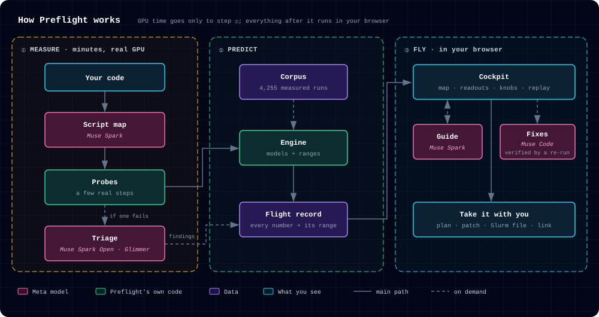

# Preflight

**A flight simulator for ML jobs.** Preflight measures a few minutes of your real training,
evaluation, serving or agent job, builds a model of how it behaves, and lets you fly the whole
run, or a whole campaign of runs, before you spend real GPU hours or API dollars.

Built during the Meta Global AI Developer Hackathon; nothing was carried over from earlier work.

**Live:** <https://preflight-cqn.pages.dev> · **The manual:** [Technical Documentation](https://preflight-cqn.pages.dev/#/help)

## Contents

- [Status](#status)
- [Try it](#try-it)
- [How it works](#how-it-works)
- [Meta models and partner tools](#meta-models-and-partner-tools)
- [What a run costs](#what-a-run-costs)
- [The corpus](#the-corpus)
- [Validation](#validation)
- [Add-ons](#add-ons)
- [Agentic workflow](#agentic-workflow)
- [Licences](#licences)

## Status

Everything below is live on the site. Samples are free and open instantly; checking in your own
code runs real probes on a rented GPU, so the public demo has limits:

- **5 check-ins a visitor a day**, plus one free resend when a check-in stopped before measuring anything;
  one network address gets at most 10 a day and 2 at once.
- **A daily GPU budget for the whole site** ($15 a day). Past it, samples and shared links still open.
- **The live guide:** up to $0.40 a tour and $10 a day for the whole site; if it's busy, the rule-based tour takes over.

| What | Where you see it | Code |
| --- | --- | --- |
| Check in your own code: a GitHub repo (with an entry point and arguments), an upload, a notebook, or an `lm_eval` command | New flight | `python/preflight/runner/` |
| Muse Spark reads your script and draws it as a map | Boarding, then the cockpit's map | `python/preflight/harness/mapper.py` |
| Four readouts with ranges: memory, time, cost, risk; "Not measured here" when it won't guess | The cockpit | `python/preflight/engine/` |
| Knobs that move the map in under 400 ms, a fit map of what fits, and a flight plan you can replay | The cockpit | `web/src/workspace/` |
| A guide that moves the knobs with you (Muse Spark, tool calls) | The cockpit's guide | `api/preflight_api/guide/` |
| Findings on failed probes: log triage (Muse Spark Open), a diagnosis of plots against numbers (Muse Spark, number-checked by Muse Spark Open), and known issues from a web search | The record's findings | `python/preflight/harness/` |
| Private mode: logs triaged by Muse Glimmer on Preflight's own GPU, never sent to Meta or Baseten | New flight, "Private triage" | `python/preflight/glimmer/` |
| Fix loop: Muse Code writes fixes, and Preflight's own re-run keeps only the ones that work | A finding's "Fix it" | `api/preflight_api/fix/` |
| In-flight mode: watch your real run against its predicted bands | Logbook, "Watch a real run" | `python/preflight/recorder/` |
| Campaigns: a grid of runs on a calendar, with team lanes | The campaign sample | `python/preflight/campaign/` |
| Exports: the plan, a code patch, a Slurm file, the run command, a share link | Under the flight plan | `web/src/workspace/export/` |
| Checks against real full runs, hits and misses | The Checks page | `docs/validation/` |

Not shipped: the divergence warning model, a serving throughput model and a loss forecast. Each
was built and measured, and set aside when it missed its target ([Validation](#validation)).

## Try it

**In the browser:** open <https://preflight-cqn.pages.dev>. Pick a sample to open it in the
cockpit, or check in your own code under New flight. [The manual](https://preflight-cqn.pages.dev/#/help)
explains every input and knob.

**From this repo, with no account or key:** the cockpit runs locally with every sample, the knobs,
the replay and the rule-based guide.

```bash
git clone https://github.com/uchuuronin/preflight && cd preflight/web
npm ci && npm run dev                             # open http://localhost:5173
```

To have Muse Spark guide you live, run the API beside it with your own Meta Model API key (the names
are in `.env.example`; never commit a filled-in copy):

```bash
cd ../api                                         # from preflight/web
export META_API_KEY=...  META_API_BASE=...        # from the Meta dashboard's API page
PREFLIGHT_FLAGS='{"c.guide.live": true}' uv run uvicorn preflight_api.app:create_app --factory --port 8000
```

Then open <http://localhost:5173/?flags=c.guide.live#/cockpit/lora-qwen>: the `?flags=` part turns the
live guide on in the browser too, and the guide panel says "Muse Spark" instead of "Rule-based tour".

Checking in your own code needs a GPU, so it runs on the hosted site, or on your own GPU with
`preflight run` below.

**On your own machine** (Python 3.11 or 3.12, in the environment that has your torch):

```bash
pip install git+https://github.com/uchuuronin/preflight
# or with PyTorch too:  pip install "preflight[probe] @ git+https://github.com/uchuuronin/preflight"

preflight demo                                    # a first run on this machine, about a minute
preflight map train.py                            # read your script without running it
preflight run . --entrypoint train.py -- --batch_size 16    # measure a few real steps; your args go after --
preflight watch records/<share_token>.json train.py         # run it for real against its predicted bands
```

Install from the GitHub URL: `pip install preflight` on PyPI is an unrelated package. On a machine
without an NVIDIA GPU, install PyTorch's CPU build first (`pip install torch --index-url
https://download.pytorch.org/whl/cpu`); the default build pulls about 5 GB of CUDA libraries. Records land
in `records/`; to fly the whole run in the cockpit, check the script in on the site.

**Share a flight:** every record has a link, `https://preflight-cqn.pages.dev/s/<share token>`,
whose preview shows its headline numbers. For a README badge:
`[](https://preflight-cqn.pages.dev/s/<share token>)`.

**Verify a fix in your own CI:** a GitHub Action fails the job unless a fix improved what it was for
and left the run's meaning alone (same effective batch, tokens and schedule, throughput no worse
than 90%, same fixed-seed loss). Standard library only, no keys.

```yaml
# .github/workflows/preflight-verify.yml
on: pull_request
jobs:
  verify:
    runs-on: ubuntu-latest
    steps:
      - uses: actions/checkout@v4
      - uses: uchuuronin/preflight/.github/actions/verify@main   # pin a commit hash
        with:
          before: preflight/before.record.json   # the run before the fix
          after: preflight/after.record.json     # the verify run after it
          metric: memory.peak                    # what the fix was for
```

**Develop:**

```bash
uv sync                                       # Python env with dev tools
npm ci                                        # schema codegen
uv run pytest -q                              # tests
uv run ruff check . && uv run ruff format --check .
uv run python -m preflight.schema.generate    # after any schema change
```

Probes need PyTorch: `uv pip install torch --index-url https://download.pytorch.org/whl/cpu` for a
CPU, or the CUDA or ROCm wheel on a GPU box.

## How it works

GPU time goes only to a few minutes of probes. Everything you explore afterwards is computed in the
browser from the flight record.



## Meta models and partner tools

| Tool | What it does in Preflight | Status |
| --- | --- | --- |
| **Muse Spark** (Meta Model API) | Reads each script into a map; runs the guide with tool calls; diagnoses a finished record's plots against its numbers; searches the web for known issues on a failed probe | Live. About $0.02 a script map |
| **Muse Spark Open** (open weights, on Baseten) | Triages each failed probe's log, quoting the line it read (code checks the quote); checks every number in a model-written finding against the raw measurements | Live. Number check: 94% of true numbers passed, 91% of altered ones caught |
| **Muse Glimmer** (open weights, Apache 2.0) | Private mode: triages logs on Preflight's own GPU, so they never leave | Live. Agreed with Muse Spark Open on 9 of 11 failed probes (52% to 95%) |
| **Muse Code** (headless) | The fix loop: writes candidate fixes in a sandbox; Preflight's re-run decides, never Muse Code's exit code | Live. On the LoRA sample's eval OOM, it rejected one fix and kept the one that passed (eval peak 10.4 GiB) |
| **Modal** | GPU sandboxes for probes, the job store and API, the corpus sweep, the fix sandboxes | Every NVIDIA measurement |
| **AMD MI300X** (rented) | ROCm probes and the AMD slice of the corpus | Measured: the planted OOM caught on the MI300X too; NVIDIA-to-AMD step time isn't predictable yet, so it abstains |
| **Cloudflare Pages** | The web app, the API's edge, and share pages | Live |

Every model Preflight calls at runtime is one of Meta's four above. Everything else is Preflight's own
code: the engine's predictions come from formulas and small statistical models fitted on Preflight's
own measured corpus, not from a pretrained model.

**What's real and what isn't:** a sample labelled with its GPU and date is a real recorded run;
the others say "Example numbers". Every number on screen says whether it was measured, predicted or extrapolated, or reads "Not measured here". The
guide without a Meta key is a rule-based tour, and says so. Without Muse Spark, a script map falls
back to Preflight's static reader, and the record says which one drew it.

## What a run costs

- **One check-in of the LoRA sample:** $0.11 to $0.21, in 5 to 10 minutes on an L4 or A10.
- **What it's spent on:** GPU time for the probes, plus about $0.02 of Muse Spark for the script map.
- **Exploring afterwards:** free. Knobs, the flight plan and the fit map run in your browser.

## The corpus

- **What it is:** the measurements behind Preflight's models and its held-out checks:
  [huggingface.co/datasets/chaoschia/preflight-corpus](https://huggingface.co/datasets/chaoschia/preflight-corpus).
- **What it holds:** 4,255 rows: 3,129 small training configs timed over eight GPUs (MI300X
  included), 100 Hugging Face fine-tuning jobs, and 1,026 short runs labelled for divergence.
- **Each row:** memory, step time and per-op profiles, or a run's loss and gradient curves.
- **Datasheet:** how it was made, what it covers and where it's biased:
  [`python/preflight/corpus/DATASHEET.md`](python/preflight/corpus/DATASHEET.md).
- **Licence:** Apache 2.0, like the repository.

## Validation

Preflight was scored against real full runs of its bug-zoo scripts and one outside script, with the engine frozen before any of them was scored. In short:

- **It catches the crash that costs the most.** It called out-of-memory right on 10 of 11 scripts (it ran out or it didn't), with no false alarms, and found 6 of 7 planted bugs.
- **It's far closer than asking a model.** On the same scripts, Preflight's step time was off by 8% to 36%; Muse Spark reading the code alone was off by 1.6× to 18×. Peak memory within 10%: Preflight 2 of 4, Muse Spark 0 of 4.
- **It's fast and cheap.** The knobs answer in 68 ms on the live site, and a check-in costs under $1.
- **Where it's still short:** memory that keeps growing after the probes end, such as an allocator pool that grows for epochs or an evaluation after training. The per-script table says which scripts and why, and the ranges on screen are widened to match.

Each count carries a Wilson 95% interval, so a small sample never reads better than it is. The
same checks, and the side-by-side with Muse Spark, are on the site's
[Checks page](https://preflight-cqn.pages.dev/#/checks).

<!-- validation:start -->
| Check | Target | Result | 95% interval | What's going on |
|---|---|---|---|---|
| Out-of-memory prediction | No missed OOMs | 10 of 11 | 62% to 99% | Right on 10 of 11 scripts, with no false alarms. Of the 3 that ran out, it caught 2; the one it missed is a retrieval script where no probe ran |
| Planted problems caught | All of them | 6 of 7 | 48% to 98% | The one it missed is a vision script's missing channels-last layout, a speed setting rather than a crash |
| Knob response | Under 400 ms | 120 of 120 | 96% to 100% | 95th percentile 68 ms on the live site |
| Agent run total cost | Inside the 90% range | 1 of 1 | 20% to 100% | Predicted $5.90 to $13.71; the full run cost $6.66. One run so far |
| Cost of one check-in | Under $1 and 5 minutes | 1 of 2 | 9% to 91% | Both cost under $1; one took 10 minutes |
| Peak memory | Within 10% | 3 of 8 | 13% to 70% | Close when the peak happens during training; low when memory grows after the probes end (per script, below) |
| Step time, same GPU | Within 15% | 3 of 6 | 18% to 82% | Off by 8% to 36% on the four bug-zoo scripts; causes per script below |
| Step time, a GPU never probed | Within 20% | 57% of 6,694 | 55% to 59% | Simulated on held-out GPUs; the range on screen is widened to match |
| 90% ranges cover the truth | At least 88% | 10 of 18 | 33% to 76% | Mostly the same memory that grows after the probes end |
| Abstains outside what it measured | Always | checked in CI | | `tests/test_engine_api.py` |
| RL rollout time · serving throughput | Within 20% · 15% | not yet scored | | No full run yet |
<!-- validation:end -->

**Predicted against the real run, per script** (the bug zoo, each run to the end):

| Script | Peak memory | Step time | Why |
| --- | --- | --- | --- |
| GNN (GraphSAGE) | 39% under | within 15% | The allocator's pool keeps growing for three epochs, past any probe |
| Retrieval (sentence encoder) | 57% under | 22% over | The peak is in the script's own evaluation after training; the step error is the recorder's own overhead |
| Vision (ResNet-50) | within 10% | 17% under | Two data-loader workers stall once their prefetched batches run out |
| Pretrain (nanoGPT) | within 10% | 36% over | The probe's timed steps ran slow; not yet explained |
| LoRA fine-tune (Qwen2.5-1.5B) | out of memory, predicted | | Its planted eval bug: caught before the run on an L4, an A10 and an MI300X |

**Tried and set aside**, each measured first:

- **Divergence warning model:** AUROC 0.66 (0.56 to 0.76) against a 0.85 target. Threshold rules give the warning instead.
- **A learned correction for unprobed GPUs:** no better than the formula (57% against 57%), so the formula is used.
- **GNN + GBDT ensemble:** a +4.8% gain whose interval includes zero (−1.4% to +11.6%).
- **Loss forecast (LC-PFN):** its ranges covered 74% of real loss curves at 150 steps, short of 90%, so no loss forecast ships.
- **A reserved-memory margin:** fixed none of the memory misses and lost a hit.

## Add-ons

| Add-on | What a visitor gets |
| --- | --- |
| Detail level | "New to this" shows the few knobs that matter most, in plain words, with a glossary card on each |
| Costs in your currency | 30 currencies at the European Central Bank's dated reference rates |
| Free GPUs | Whether the plan fits one free session on Colab, Kaggle, Modal or Lightning AI, and how often to checkpoint if not |
| Notebook | Check in a Jupyter notebook: it previews the script and requirements that will run |

## Agentic workflow

Preflight was built by one person directing four Claude agents, each owning one part of the repo:

- **A:** probes, the recorder and the runner.
- **B:** the prediction engine, the corpus and validation.
- **C:** the web app, the API, the guide and deploys.
- **D:** the add-ons, docs, the video and search grounding.

They shared one contract ([CONTRACT.md](CONTRACT.md)) for the record format and who owns which path,
and talked through request files in `docs/requests/`. A PM agent merged their branches, ran every
check (tests, a stranger test that walks the live site, a secrets scan) and kept the feature flags.
Every push had a read-only review first. An independent reviewer model re-validated the held-out
results, and I checked the work throughout to keep everything aligned.

## Licences

- **Preflight:** Apache License 2.0 ([LICENSE](LICENSE)).
- **Dependencies:** every bundled package and its licence is in
  [docs/licences.md](docs/licences.md); CI fails on a GPL, AGPL or SSPL dependency, or one that
  names no licence.
- **Share cards** (`workers/functions/_card/`): resvg-wasm 2.6.2, vendored unmodified under
  MPL-2.0 (its `LICENSE` beside it), and the fonts Instrument Sans, Instrument Serif and
  JetBrains Mono under the SIL Open Font License 1.1.
- **Meta's models:** Muse Spark and Muse Spark Open are called through their hosted APIs, and Muse
  Code is Meta's command-line tool, all under Meta's and Baseten's terms. Muse Glimmer's weights
  (Apache 2.0) are downloaded from Meta's Hugging Face repository at run time; none are in this
  repository.
- **The corpus:** Apache 2.0, like the repository.
- **torchtitan test files** (`zoo/torchtitan_debug/`): torchtitan's own debug config, test
  tokenizer and `c4_test` slice, from its v0.1.0 tag, under BSD-3-Clause (`LICENSE.txt` beside
  them). The `c4_test` slice is text from C4 by AllenAI, released under ODC-BY 1.0; Common
  Crawl's terms of use apply to its content.
- **Hugging Face's text-classification notebook** (`validation/fresh/f2/`): unchanged, Apache-2.0,
  © Hugging Face; kept only so a check-in can send it the way a visitor's upload would.
- **Bug-zoo scripts:** written for Preflight. They download public models and data at run time
  and bundle none of them:

| Script | Model (licence) | Data (licence) |
| --- | --- | --- |
| `finetune_lora_hf` | Qwen/Qwen2.5-1.5B (Apache 2.0) | yahma/alpaca-cleaned (CC BY 4.0) |
| `pretrain_nanogpt` | GPT-2 tokenizer (MIT) | roneneldan/TinyStories (CDLA-Sharing 1.0) or random tokens |
| `grpo_trl` | Qwen/Qwen2.5-0.5B-Instruct (Apache 2.0) | openai/gsm8k (MIT) |
| `agent_eval_spark` | muse-spark-1.3, hosted (Meta's terms) | google-research-datasets/mbpp (CC BY 4.0) |
| `eval_sweep_reasoning` | DeepSeek-R1-Distill-Qwen 1.5B and 7B (MIT; distilled from Qwen2.5, Apache 2.0) | openai/gsm8k (MIT) |
| `serving_vllm` | Qwen/Qwen2.5-7B-Instruct (Apache 2.0) | databricks/databricks-dolly-15k (CC BY-SA 3.0) |
| `retrieval_st` | sentence-transformers/all-MiniLM-L6-v2 (Apache 2.0) | sentence-transformers/natural-questions (CC BY-SA 3.0, from Google's Natural Questions) |
| `gnn_pyg` | none (trained from scratch) | synthetic graph made in the script |
| `notebook_tiny` | none (a small MLP trained from scratch) | random tensors made in the script |
| `vision_timm` | timm/resnet50.a1_in1k (Apache 2.0) | AI-Lab-Makerere/beans (MIT) |
