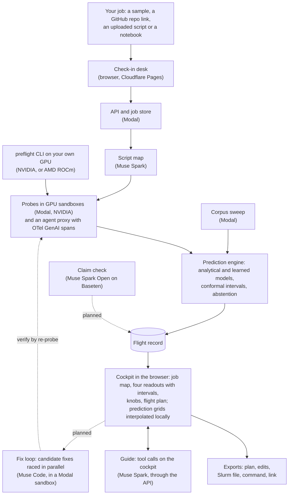

<!--
README draft by D, Sat Oct 31, for the PM to merge into README.md (submission checklist in the
plan). Placeholders to fill before Nov 4 are marked TODO(PM). Every number carries its source.
The validation table is B's scorer output between the `validation:start` and `validation:end`
markers: keep both when merging, since the scorer rewrites what is between them. Where a feature
is still behind a flag or not yet wired, its row says so: update those rows from the status
files at merge time.
-->

# Preflight

**A flight simulator for ML jobs.** Preflight measures a few minutes of your real training,
evaluation, serving or agent job, builds a model of how it behaves, and lets you fly the whole
run, or a whole campaign of runs, before you spend real GPU hours or API dollars.

Everything in this repository was built during the Meta Global AI Developer Hackathon
(Oct 26 to Nov 4, 2026). The first commit is `11a0ce9`, Oct 26, 22:25 ET; nothing was carried
over from earlier work.

## Try it

**In the browser, no install:** open TODO(PM): public link. Pick a sample to open it straight in
the cockpit (samples use illustrative numbers and cost nothing), or check in a public GitHub repo
link or an uploaded script to have it measured.

**On your own machine, one command** (Python 3.11 or 3.12, in the environment that has your
torch):

```bash
pip install git+https://github.com/uchuuronin/preflight
```

**Quickstart:**

```bash
# 1. Read the script without running it (seconds): lens, framework, knobs and where the code sets them.
preflight map train.py

# 2. Measure a few steps on this machine (its GPU if it has one) and write a flight record.
#    On a real script this takes a few minutes: probes run real training steps.
preflight run . --entrypoint train.py --out .preflight/records

# Arguments for your script go after --, e.g.
preflight run . --entrypoint train.py -- --batch_size 16
```

The record lands in `.preflight/records/<share_token>.json`, a JSON flight record. Opening a local
record in the web app isn't built yet: the app opens records by their share link.
(Checked Oct 31 by D: the package installed from this checkout in a fresh Python 3.11
environment with torch 2.5.1 ran three probes of a small torch loop on the CPU and wrote a record;
the GitHub install line itself can be tried once the repository is public.)

## How it works

GPU time goes to a few minutes of probes, a background corpus sweep and verify runs; everything a
visitor explores afterwards is computed in the browser from the flight record.



The shared interfaces (flight record, prediction API, job events, UI extension points) and who
owns which path are in [CONTRACT.md](CONTRACT.md).

## Meta models and partner tools

| Tool | Where it is used | Status on `main` (TODO(PM): update at merge) |
| --- | --- | --- |
| **Muse Spark** (`muse-spark-1.3`, Meta Model API) | Maps each script with structured output (`python/preflight/harness/`); runs the guide through the Responses API with tool calls on the live cockpit (`api/preflight_api/guide/`); the model behind the agent bug-zoo script (`zoo/agent_eval_spark/`) | Script map in every measured job; guide behind `c.guide.live` |
| **Muse Code** (headless) | Fix loop: candidate fixes raced in parallel worktrees inside a sandbox, edits only; the API key reaches Muse Code on stdin only, never in its environment or files; each fix is gated on Preflight's own re-probe and verify, not on Muse Code's exit code (`api/preflight_api/fix/`) | Backend and one smoke run (a fix landed in 45 s; `docs/status/c.md`, Oct 31); not reachable from the app yet (no `/v1/patches`, no race on screen) |
| **Muse Spark Open** (Baseten) | Checks each number a finding or the guide states against the record's raw probe numbers; code does the checking, the model only picks which field a sentence means (`python/preflight/harness/claim_check.py`) | Module written; not wired into the pipeline (`docs/status/a.md`, items 29 and 30) |
| **Muse Glimmer** | One of three models in the agent model sweep's price table (`python/preflight/engine/prices/`) | Private mode is a proposal (`docs/decisions/glimmer-host.md`) |
| **Modal** | Probes in GPU sandboxes, the job store and API, the background corpus sweep, the fix loop's sandboxes | Used for every measured run so far (Oct 28 to 31, `docs/status/a.md`); public deploy pending |
| **AMD Developer Cloud** | ROCm probes through the CLI on an MI300X, and the AMD half of the corpus, with AMD kernel names (`python/preflight/corpus/`, `.github/workflows/amd-run.yml`) | Prepared; no MI300X result yet (`docs/status/a.md`) |
| **Cloudflare Pages** | The web app, and the `/v1` edge function that forwards to the API with a shared secret and the visitor's address for quotas (`web/functions/`, `api/preflight_api/edge.py`) | Built; waits on the Pages project (C, Oct 31) |

## What a run costs to measure

One run so far (A, Oct 28, job `a-smoke-l4-main-4`, the LoRA fine-tune zoo script): upload to
flight record in 6 min 45 s [measured], with 386 s of probe time on one L4 [measured]; that is
over the plan's 5-minute target. GPU $0.0858 [derived: measured probe time at the L4 list rate]
and Muse Spark $0.0178 [derived: reported tokens at list prices]. The sandbox's CPU and memory
are not in that total yet; Modal's bill replaces the estimate.
TODO(PM): replace with the validation table's "Cost of one Preflight run" row once scored.

## Validation

Every prediction is checked against real full runs, hit or miss. B's scorer fills this table on
Mon Nov 2 from the bug zoo's and the unseen scripts' full runs; the policy is frozen before then.
Everything between the two `validation` markers is the scorer's output, written by
`uv run --extra probe python scripts/score_validation.py <manifest.json> --readme README.md`;
nothing in it is edited by hand.

<!-- validation:start -->
| Metric | Target | Measured on | Result | 95% interval | Hit | Notes |
|---|---|---|---|---|---|---|
| Peak memory error | Within 10% | Bug zoo and unseen scripts, full runs | not measured |  |  | no full run scored yet |
| OOM prediction | No missed OOMs; at most 1 false alarm per 10 scripts | Bug zoo and unseen scripts | not measured |  |  |  |
| Step time, same GPU | Within 15% | Full runs | not measured |  |  | no full run scored yet |
| Step time, unmeasured GPU | Within 20% | Train on 3 GPU types, test on the 4th | not measured |  |  | no corpus store given |
| GNN + GBDT ensemble vs GBDT alone | Lower error on held-out architectures | Corpus holdout |  |  | miss | paired gain +4.8% (95% -1.4% to +11.6%); the interval includes zero, so the GBDT is used |
| Divergence warning | AUROC 0.85+, 100+ steps early | Held-out short runs | not measured |  |  | the classifier's held-out report isn't in yet |
| Rollout time (RL) | Within 20% | An unseen TRL script (the GRPO zoo script calibrated it, Nov 1) | not measured |  |  | no full run scored yet |
| Serving tokens/sec | Within 15% | vLLM full runs | not measured |  |  | no full run scored yet |
| Agent run total cost | Inside the 90% interval | Full benchmark run vs the 30-task sample | not measured |  |  | no full run scored yet |
| Interval coverage | 90% intervals cover at least 88% | All of the above | not measured |  |  | no full run scored yet |
| Abstention | Every query outside the probed range is flagged | Automated test | not measured |  |  | tests/test_engine_api.py, run with the suite |
| Planted problems caught | All of them | Bug zoo | not measured |  |  |  |
| Unseen scripts harnessed | 8 of 9 without hand edits | One per job type | not measured |  |  |  |
| Knob response | Under 400 ms at p95 | Browser timing | not measured |  |  | no browser timings given |
| Cost of one Preflight run | Under $1 and under 5 minutes | Modal billing and timer | not measured |  |  | no full run scored yet |
A "within" target is a hit when at least 90% of runs are within it; intervals are Wilson 95% on the proportion, and a hit is "confident" only when its lower end is at least 90% ("hit, few runs" otherwise). Unseen scripts are never tuned on. Not scored yet: no full runs (seeded from the scorer with an empty manifest, Nov 1).
<!-- validation:end -->

## Add-ons

Smaller features, each behind its own flag in `flags.json` (all off until Chiya turns them on).
`docs/audit/scripts/addons.mjs` checks that each still renders where it belongs, with no errors,
no accessibility violations inside it and nothing under 24 px, and that it is gone with its flag
off. TODO(PM): keep only the rows whose flags are on in production.

| Add-on | What a visitor gets | Flag |
| --- | --- | --- |
| Detail level (D1) | "New to this" shows the few knobs that matter most for the goal, in plain words, with a glossary card in each knob's control; knobs that a warning names stay in view | `d.expertise` |
| Show costs in (D3) | Dollar figures in one of 30 currencies at the European Central Bank's dated reference rates, picked from the browser's region or set in the Logbook; regions without a rate stay in US dollars | `d.currency` |
| Free GPUs (D4) | Whether the plan finishes inside one free session on Google Colab, Kaggle, Modal's starter credit or Lightning AI, and how often to save a checkpoint if not | `d.freetier` |
| Notebook (D5) | A check-in tab for a Jupyter notebook: it previews the script and requirements that would run; checking it in opens with live runs | `d.notebook` |
| Take it with you | The plan, an edit script for the changed settings, a Slurm batch file and the run command, built from the settings on screen, and the record's link once it has one | `c.exports`; the "Check it again on your machine" item also needs `d.exports_cli` |

## Develop

```bash
uv sync                                   # Python 3.11 env with dev tools
npm ci                                    # schema codegen (json-schema-to-typescript)
uv run pytest -q                          # tests
uv run ruff check . && uv run ruff format --check .
uv run python -m preflight.schema.generate   # after any schema change
```

Probes need PyTorch: `uv pip install torch --index-url https://download.pytorch.org/whl/cpu`
for CPU, or the CUDA or ROCm wheel on a GPU box.

## Licences

- **Preflight:** Apache License 2.0 ([LICENSE](LICENSE)).
- **Dependencies:** every bundled package and its licence is in
  [docs/licences.md](docs/licences.md); CI fails on GPL, AGPL and SSPL.
- **Bug-zoo scripts:** written for Preflight. They download public models and data at run time
  and bundle none of them:

| Script | Model (licence) | Data (licence) |
| --- | --- | --- |
| `finetune_lora_hf` | Qwen/Qwen2.5-1.5B (Apache 2.0) | yahma/alpaca-cleaned (CC BY 4.0) |
| `pretrain_nanogpt` | GPT-2 tokenizer (MIT) | roneneldan/TinyStories (CDLA-Sharing 1.0) or random tokens |
| `grpo_trl` | Qwen/Qwen2.5-0.5B-Instruct (Apache 2.0) | openai/gsm8k (MIT) |
| `agent_eval_spark` | muse-spark-1.3, hosted (Meta's terms) | google-research-datasets/mbpp (CC BY 4.0) |
| `eval_sweep_reasoning` | DeepSeek-R1-Distill-Qwen 1.5B and 7B (MIT; distilled from Qwen2.5, Apache 2.0) | openai/gsm8k (MIT) |
| `serving_vllm` | Qwen/Qwen2.5-7B-Instruct (Apache 2.0) | databricks/databricks-dolly-15k (CC BY-SA 3.0) |
| `retrieval_st` | sentence-transformers/all-MiniLM-L6-v2 (Apache 2.0) | sentence-transformers/natural-questions (CC BY-SA 3.0, from Google's Natural Questions) |
| `gnn_pyg` | none (trained from scratch) | synthetic graph made in the script |
| `vision_timm` | timm/resnet50.a1_in1k (Apache 2.0) | AI-Lab-Makerere/beans (MIT) |
