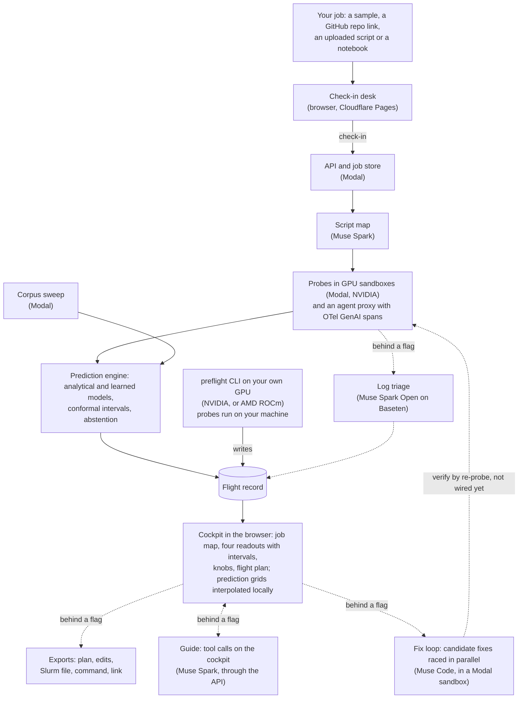

# Preflight

<!-- TODO(PM): once the site is live and workers/ is in the deploy, uncomment the badge and
replace TODO-PM-HOST with the live host. It reads A's Oct 28 record (a-smoke-l4-main-4) and shows
its first headline number with its status word; until then it would be a broken image.
[](https://TODO-PM-HOST/s/ICDYrfHQ2nBNbv3mlRHHMg)
-->

**A flight simulator for ML jobs.** Preflight measures a few minutes of your real training,
evaluation, serving or agent job, builds a model of how it behaves, and lets you fly the whole
run, or a whole campaign of runs, before you spend real GPU hours or API dollars.

Everything in this repository was built during the Meta Global AI Developer Hackathon
(Oct 26 to Nov 4, 2026). The first commit is `11a0ce9`, Oct 26, 22:25 ET; nothing was carried
over from earlier work.

## Status

As of Sun Nov 1 (round five). Every feature ships behind a flag that is off until its check
passes (`flags.json`); `flags.production.json` turns on what the public site runs. The public site
is live at <https://preflight-cqn.pages.dev>.

**On in production**

| What | Where it shows | Source |
| --- | --- | --- |
| Muse Spark reads each script (the script map) | Boarding's "Reading your script", and the cockpit's job map | `harness.spark_script_map`, on in `flags.production.json` (Chiya, Nov 1) |
| Predictions with intervals and abstention: memory, step time, cost, risk | The cockpit's four readouts, the knobs and the flight plan | `engine.memory`, on in production (Chiya, Oct 30); it gates the whole prediction step (`runner/pipeline.py`) |
| Campaign calendar | The campaign sample (illustrative numbers, B's planner on a 12-run grid) | `c.campaign_calendar`, on in production (Chiya, Nov 1) |
| Checking in your own repo or script | New flight's Repo link and Upload tabs: Preflight runs a few probe steps of your job on a rented GPU, sandboxed, and opens the record in the cockpit and a Notebook tab for a Jupyter notebook (`d.notebook`, on in production since Nov 2: a training notebook checked in end to end, A's `a-notebook-checkin-3`) | `runner.queue`, on in production (Chiya, Nov 1). Demo limits: 3 probe jobs per visitor per day, and a daily GPU spend cap for the whole site (US$10 a day through Nov 4, US$8 a day from Nov 5) [cited: `python/preflight/runner/queue.py`, in the runner A deployed from `1ea2dd6`, Nov 2]. Past either, the site opens samples and shared records only until midnight ET |
| The guide (Muse Spark moves the knobs with tool calls) | The cockpit's guide panel | `c.guide.live`, on in production (Chiya, Nov 1). Smoke runs pass: GitHub run 41273350602, 5 rounds, all called tools [measured], US$0.019 [derived: reported tokens at list prices]. Its spend limits: US$0.40 a tour [derived], and US$10 a day for the whole site [guess: the code's value, pending Chiya's answer], with round limits per visitor and per address (`api/preflight_api/ledger.py`). If the live guide fails before it answers, the rule-based tour starts in its place (`web/src/guide/GuidePanel.tsx`) |
| Fit map: which settings fit, with the out-of-memory frontier | The cockpit's Fit view: drag your run across the map | `c.fit_map`, on in production (Chiya, Nov 1) |
| RL readouts: the share of prompt groups with no reward spread, rollout time | The GRPO lens | `engine.rl`, on in production (Chiya, Nov 1); calibrated on A's GRPO runs (L4 smoke runs and a 50-step run on an A10) |
| Log triage by Muse Spark Open on Baseten | A probe that fails gets a finding quoting its log line, labelled "Found by Muse Spark Open triage" | `harness.spark_open_triage`, on in production with its data-use line (Chiya, Nov 1) |
| GRPO lens on a measured run | The GRPO sample: reward spread, completion lengths, the tour | A's L4 run `a-gt-grpo-l4-3`; no flag |
| Cost readout at your own rate | Every dollar readout: quantity x rate = total, with the price table's source and date | No flag |
| Verify a fix in your own CI | A GitHub Action (below) | No flag; usable from other repositories once this one is public |
| Possible outcomes (HOPs) and exports: the plan, an edit script, a Slurm batch file, the run command and a W&B script | The cockpit's "Possible outcomes" toggle, and the exports band under the whole run | `c.hops` and `c.exports`, on in production (Chiya, Nov 1, 8 PM); checked by C on all 10 samples on a production build |
| The add-ons: detail level, costs in your currency, free GPUs | The Logbook and the cockpit (below) | `d.expertise`, `d.currency`, `d.freetier`, on in production (Chiya, Nov 1, 8 PM); checked by D in Chromium, desktop and phone |
| The `preflight` CLI (`map`, `run`) | Your own machine | On `main`; the `pip install git+...` line works once the repository is public |

**Behind a flag, off for now**

| What | Flag | Where it stands |
| --- | --- | --- |
| The fix loop (Muse Code races candidate fixes) | `c.fix_loop` | Route `/v1/patches` on `main`; in a clean smoke run (41250977670) Muse Code produced the correct patch in 19 s [measured], US$0.09 [derived: reported tokens at list price]. Gating a fix on Preflight's re-probe isn't wired end to end yet (it needs A's runner to apply the patch) |
| The CLI re-check item in the exports | `d.exports_cli` | Built on `main`; on once the repository is public (Nov 3 to 4) |
| Private mode: log triage by Muse Glimmer | `harness.glimmer_private` | Hosted on Preflight's own GPU (an A100-40GB on Modal that Preflight deploys, scaled to zero when idle), behind its flag: built and checked through the production runner, and off until the data-use notice describes it. A private check-in's probe logs are triaged by Glimmer and never sent to Baseten. Triage cost US$0.24 for one call that waited through a 411 s cold start [measured: US$0.2398, A's `a-triage-glimmer-5`], and US$0.33 for 11 calls in one run, likely including one cold start [measured: US$0.3316, A's `a-triage-agreement`]. Same category as Spark Open on 9 of 11 failed zoo probes [measured, `a-triage-agreement`] |

**Not used, or not measured**

| What | Why | Source |
| --- | --- | --- |
| Divergence classifier | Still misses after a refit on 720 runs, held out by settings family: AUROC 0.66 (0.56 to 0.76) against a 0.85 target, with a lead of 138 steps (3 to 269) [measured: B's fit report], so `risk.divergence` stays off and is not used; the warning comes from the threshold rules | B's fit report, [`divergence_nov1.json`](python/preflight/corpus/reports/divergence_nov1.json) (`1cfa689`) |
| AMD | No AMD measurements: the AMD Developer Cloud account is on a verification hold, so every AMD figure says "not measured" | `docs/status/b.md`, `docs/status/a.md` |
| GBDT correction for an unmeasured GPU | Fails held out (51% within 20%, against 60% for the analytical model [measured, corpus]), so it isn't used | `docs/status/b.md` |
| Step time on an unmeasured GPU | Used, with its range, but 60% of held-out queries land within 20% [measured, corpus], under the 90% target | `docs/status/b.md` (leave-one-GPU-out on the corpus) |
| Serving model | Built, switched off (`engine.serving`) until its validation row passes | `python/preflight/engine/api.py` |
| Claim check by Muse Spark Open | Module written, not wired in | `python/preflight/harness/claim_check.py` |
| Full-run validation | Scored on Mon Nov 2 (the table below) | B's scorer |

## Try it

**In the browser, no install:** open <https://preflight-cqn.pages.dev>. Pick a sample to open it straight in
the cockpit (samples use illustrative numbers unless they say measured, and cost nothing), or open
a shared record's link. Or check in your own repo or script under New flight.

**Share a flight** (once `workers/` is in the deploy; TODO(PM)): post
`https://TODO-PM-HOST/s/<share token>`. Link previews show the record's headline numbers, each with
its status word (Measured, Predicted, Extrapolated, Not measured here or Illustrative), as text, with a
card image for the records whose card is pre-rendered, and the link opens the flight in the
cockpit.
For a README badge:
`[](https://TODO-PM-HOST/s/<share token>)`
(`workers/README.md`).

**On your own machine, one command** (Python 3.11 or 3.12). In the environment that already has
your torch:

```bash
pip install git+https://github.com/uchuuronin/preflight
```

or, to add PyTorch too (a large download from PyPI):

```bash
pip install "preflight[probe] @ git+https://github.com/uchuuronin/preflight"
```

Install from this URL, not `pip install preflight`: that name on PyPI is an unrelated package.

**Quickstart** (the first step took 23 to 24 s on a CPU here [measured]):

```bash
# 1. A first run: writes a small training script into ./preflight-demo and probes it on this
#    machine (its GPU if it has one), then writes a flight record.
preflight demo

# 2. Read your own training script without running it (seconds): lens, framework, knobs and where the code
#    sets them.
preflight map train.py

# 3. Measure a few steps of it and write its flight record. On a real script this takes a few
#    minutes: probes run real training steps. Arguments for your script go after --.
preflight run . --entrypoint train.py -- --batch_size 16
```

`preflight demo` writes its record to `preflight-demo/records/` and `preflight run` to
`records/<share_token>.json` (`--out` to change it): a JSON flight record with
the probes' measurements and findings. The web app opens records by their share link only, so to
fly the whole run, check the script in at <https://preflight-cqn.pages.dev>.
(Checked Nov 1 by D, in a clean Python 3.11 virtual environment with pip 24: `pip install
git+file://` of this repository, the same install path as the GitHub line, took 20 s, not counting
PyTorch, which was added separately [measured]; then `preflight demo` in an empty folder ran three
probes on the CPU, all ok, in 23 to 24 s, and wrote a record with the probes and two findings
[measured]. A run on a CPU carries no predictions. The GitHub line itself can be tried once the
repository is public.)

## How it works

GPU time goes to a few minutes of probes, a background corpus sweep and verify runs; everything a
visitor explores afterwards is computed in the browser from the flight record.



The shared interfaces (flight record, prediction API, job events, UI extension points) and who
owns which path are in [CONTRACT.md](CONTRACT.md).

## Meta models and partner tools

| Tool | Where it is used | Status (Nov 1, ET) |
| --- | --- | --- |
| **Muse Spark** (`muse-spark-1.3`, Meta Model API) | Maps each script with structured output (`python/preflight/harness/`); runs the guide through the Responses API with tool calls on the live cockpit (`api/preflight_api/guide/`); the model behind the agent bug-zoo script (`zoo/agent_eval_spark/`) | Script map on in production (Oct 28 runs, before the flag: US$0.0178 and US$0.0200 a job [derived: reported tokens at list prices]); the guide on in production (`c.guide.live`, Nov 1) |
| **Muse Code** (headless) | Fix loop: candidate fixes raced in parallel worktrees inside a sandbox, edits only; the API key reaches Muse Code on stdin only, never in its environment or files; each fix is gated on Preflight's own re-probe and verify, not on Muse Code's exit code (`api/preflight_api/fix/`) | Behind `c.fix_loop`; in clean smoke run 41250977670 Muse Code produced the correct patch in 19 s [measured], US$0.09 [derived: reported tokens at list price]; gating on the re-probe isn't wired end to end yet |
| **Muse Spark Open** (Baseten) | Triage: reads each probe's log tail and names the cause, quoting the line it read; code checks the quote is really in the log (`python/preflight/harness/triage.py`) | On in production (`harness.spark_open_triage`, Nov 1). First real run, A's `a-triage-lora-prod`: 4 calls on Baseten, US$0.0184 [measured]. Since A's fix (`b300684`, in A's redeploy of Nov 1, 20:20 UTC), triage also reads the probe's recorded error, and on the 11 failed probes in the zoo's records Spark Open quoted a line every time [measured, `a-triage-agreement`]. The claim check (`claim_check.py`) is written but not wired in |
| **Muse Glimmer** (open weights, Apache 2.0) | Private mode: with its flag on, triages a private job's failed probes on Preflight's own GPU (an A100-40GB on Modal that Preflight deploys), so their logs go to no outside model provider; with no Glimmer to call, such a job isn't triaged rather than sent to Baseten (`python/preflight/runner/pipeline.py`); also one of three models in the agent model sweep | Behind `harness.glimmer_private`, off. Hosted (`python/preflight/glimmer/`, `docs/decisions/glimmer-host.md`); US$0.24 for one call that waited through a 411 s cold start [measured: US$0.2398, A's `a-triage-glimmer-5`], and US$0.33 for 11 calls in one run, likely including one cold start [measured: US$0.3316, A's `a-triage-agreement`] |
| **Modal** | Probes in GPU sandboxes, the job store and API, the background corpus sweep, the fix loop's sandboxes | Every measured run so far (Oct 28 to Nov 1, `docs/status/a.md`); the runner (job store), the API and the fix app are deployed in production and stay up since Nov 1 |
| **AMD Developer Cloud** | ROCm probes through the CLI on an MI300X, and the AMD half of the corpus (`python/preflight/corpus/`, `.github/workflows/amd-run.yml`) | No AMD measurements: the account is on a verification hold |
| **Cloudflare Pages** | The web app, the `/v1` edge function that forwards to the API with a shared secret and the visitor's address for quotas (`web/functions/`), and share cards (`workers/`) | Live at <https://preflight-cqn.pages.dev>; share cards wait on `workers/` joining the deploy |

## What a run costs to measure

One run so far (A, Oct 28, job `a-smoke-l4-main-4`, the LoRA fine-tune zoo script): upload to
flight record in 6 min 45 s [measured], with 386 s of probe time on one L4 [measured]; that is
over the plan's 5-minute target. GPU $0.0858 [derived: measured probe time at the L4 list rate]
and Muse Spark $0.0178 [derived: reported tokens at list prices]. The sandbox's CPU and memory
are not in that total yet; Modal's bill replaces the estimate.
TODO(PM): replace with the validation table's "Cost of one Preflight run" row once scored.

## The corpus published with a datasheet

The measurements behind Preflight's learned models and its held-out checks are published as a
dataset: [huggingface.co/datasets/chaoschia/preflight-corpus](https://huggingface.co/datasets/chaoschia/preflight-corpus) (Hugging Face commit `0aac218`). It holds
`preflight-corpus-0.3.0.jsonl.gz` (corpus@0.3.0: 2,339 rows, 1,519 kernel configs, 100 Hugging
Face jobs and 720 divergence runs [cited: the datasheet]), `SHA256SUMS` and a dataset card. The
datasheet, after *Datasheets for Datasets*, says how it was made, what it covers and where it is
biased: [`python/preflight/corpus/DATASHEET.md`](python/preflight/corpus/DATASHEET.md). The
measurements are Apache 2.0, like the repository. **The dataset is private until it goes public
with the repository on Nov 3 to 4.**

## Validation

Predictions are checked against real full runs, hit or miss, starting with the runs scored on
Mon Nov 2. The table between the markers below scores each validation target and says so when a
row has nothing to score yet. It is written by
`scripts/score_validation.py <manifest.json> --readme README.md` from one manifest of full runs;
edit the manifest, not the table. The knob response row's timings
come from a stranger test run at 4x CPU slowdown (`KNOB_MS_OUT=out/knob_ms.json node
web/e2e/stranger.mjs`), copied into the manifest's `knob_ms` list.

<!-- validation:start -->
| Metric | Target | Measured on | Result | 95% interval | Hit | Status | Notes |
|---|---|---|---|---|---|---|---|
| Peak memory error | Within 10% | Bug zoo and unseen scripts, full runs | not measured |  |  | not yet run | no full run scored yet |
| OOM prediction | No missed OOMs; at most 1 false alarm per 10 scripts | Bug zoo and unseen scripts | 1 of 1 | 20% to 100% | hit, few runs | measured | missed: none; false alarms: none; reliability: 95%-100%: 1 of 1 ran out |
| Step time, same GPU | Within 15% | Full runs | not measured |  |  | not yet run | no full run scored yet |
| Step time, unmeasured GPU | Within 20% | Train on 4 GPU types, test on the 5th; no AMD measurements | 3826 of 6694 | 55% to 59% | miss | simulated | K1 roofline, 6694 config pairs over A10, H100-SXM-80GB, L4, L40S, T4; lowest held out: T4, 232 of 454 |
| GNN + GBDT ensemble vs GBDT alone | Lower error on held-out architectures | Corpus holdout |  |  | miss | simulated | paired gain +4.8% (95% -1.4% to +11.6%); the interval includes zero, so the GBDT is used |
| Divergence warning | AUROC 0.85+, 100+ steps early | Held-out short runs | 720 runs |  | miss | simulated | AUROC 0.66 (0.56 to 0.76); warns 138 steps early (3 to 269); bootstrap over settings families (the sweep is one architecture); 44 of 720 runs diverged; not used: the warning comes from the threshold rules (D6): 37 of the 44 divergences are fp16 blow-ups and 15 of 44 come in the first 30 steps, before the classifier's 25-step window can say much; held-out AUROC 0.66 against the 0.85 target; median lead 138 steps (95% 3 to 269): the point estimate clears 100, the interval doesn't |
| Rollout time (RL) | Within 20% | An unseen TRL script (the GRPO zoo script calibrated it, Nov 1) | not measured |  |  | not yet run | no full run scored yet |
| Serving tokens/sec | Within 15% | vLLM full runs | not measured |  |  | not yet run | no full run scored yet |
| Agent run total cost | Inside the 90% interval | Full benchmark run vs the 30-task sample | 1 of 1 | 20% to 100% | hit, few runs | measured | agent_eval_spark: predicted $7.15 (90% $5.90 to $13.71), the full run cost $6.66 |
| Interval coverage | 90% intervals cover at least 88% | All of the above | 1 of 1 | 20% to 100% | hit, few runs | measured |  |
| Abstention | Every query outside the probed range is flagged | Automated test | checked on every CI run |  |  | test suite | tests/test_engine_api.py, run with the suite |
| Planted problems caught | All of them | Bug zoo | 3 of 3 | 43% to 100% | hit, few runs | measured |  |
| Unseen scripts harnessed | 8 of 9 without hand edits | One per job type | 0 of 6 | 0% to 40% | miss | measured |  |
| Knob response | Under 400 ms at p95 | Browser timing | 9 of 9 | 70% to 100% | hit, few runs | measured | p95 198 ms; stranger test: build main cfcf83c, vite preview, base http://127.0.0.1:4173, cpu slowdown 4x, measured at 2026-11-02T05:28:36.930Z |
| Cost of one Preflight run | Under $1 and under 5 minutes | Modal billing and timer | not measured |  |  | not yet run | no Preflight run's cost and time given |
A "within" target is a hit when at least 90% of runs are within it; intervals are Wilson 95% on the proportion, and a hit is "confident" only when its lower end is at least 90% ("hit, few runs" otherwise). Status: "measured" is scored against what real runs did; "simulated" is the engine replaying held-out corpus measurements it never saw, with no full run launched; "not yet run" waits for Monday's runs; "test suite" is checked by the automated tests on every CI run. Unseen scripts are never tuned on. Scored 2026-11-02 16:54 UTC from manifest_unseen_nov2.json: 8 runs scored; not measured yet: unseen-1, unseen-5, unseen-6 (3); 8 of the 9 with records held out of at least one row. Used for calibration, so not held out: finetune_lora_hf (step, intervals); grpo_trl (every row). Engine flags on (flags.json with flags.production.json): engine.rl, engine.steptime_cross_gpu. Models: agent-bootstrap-cp@0.1.0, agent-context-fill@0.1.0, agent-time-concurrency@0.1.0, cost-gpu-hours@0.1.0, input-check@0.1.0, memory-analytical@0.3.1, rl-rollout-bootstrap@0.1.0, rl-zero-spread@0.1.0, steptime-phases@0.2.0, time-total@0.1.0, calibration table 50ea0fb14a.
<!-- validation:end -->

### How these numbers were made

- **Frozen engine.** Every unseen script is predicted by the engine, harness and runner as of commit `56c2141` (branch `freeze/validation`, declared Nov 2 2026 at 06:42 ET, before any agent opened the unseen list), with calibration table `50ea0fb14a`. The table is scored from a separate checkout of that commit, so the frozen commit is what every row measures; fixes made afterwards are scored apart, as below.
- **The list was fixed first.** The SHA-256 of the unseen-scripts list was committed on Nov 1 at 01:46 EDT, before the clocks went back that night (`4ca3704`, `docs/validation/unseen-hash.txt`), before any validation run. The list contains a random salt, so the hash can't be matched by guessing. It was published on Nov 2 as `docs/validation/unseen-scripts.md`, and `uv run python scripts/check_unseen_hash.py docs/validation/unseen-scripts.md` matches it to that hash.
- **First attempts only.** Each row counts each script's first attempt on the frozen commit. If a script needed a fix to run, or a bug the runs found was fixed after the freeze, the later result is reported separately as "after freeze" and never changes these rows. Zoo runs that were used to calibrate a model (named in the stamp under the table) are left out of the rows they calibrated.
- **The hit rule.** A "within X%" row is a hit when at least 90% of the runs land within it. A hit is "confident" only when the lower end of its Wilson 95% interval is at least 90%; otherwise it reads "hit, few runs". The agent-cost row needs every full run inside the sample's 90% interval, and interval coverage needs at least 88% of the scored values inside their 90% intervals.
- **Wilson intervals.** Every hit count carries a Wilson 95% interval on the proportion, rounded outwards (the lower end down, the upper end up), so a small sample never reads better than it is.
- **Status.** "measured" is scored against what real runs did; "simulated" is the engine replaying held-out corpus measurements it never saw, with no full run launched; "not yet run" has nothing to score yet; "test suite" is checked by the automated tests on every CI run.

### The unseen scripts, first attempts (Nov 2)

Nine public scripts, one per job type, picked and hashed before the runs, each run once as a visitor would send it, on the frozen commit `56c2141` (A's status file, "Unseen validation runs (Nov 2)", has each run). The table above is the frozen scorer's output on those first attempts with the zoo runs we already had. In plain words:

- **Hit:** OOM prediction (1 of 1: the zoo LoRA run's eval OOM, predicted at 100%), agent run total cost (1 of 1: the 500-task MBPP run's $6.66 inside the 30-task sample's $5.90 to $13.71), planted problems caught (3 of 3), knob response (9 of 9 under 400 ms, p95 198 ms), interval coverage (1 of 1). All of these are **"hit, few runs"**: one to nine runs each, so none is a confident hit.
- **Missed:**
  - **Unseen scripts harnessed: 0 of 9 without hand edits** (Wilson 95% 0% to 30%), against a target of 8 of 9. Three were refused before any probe (lm-evaluation-harness and vLLM as larger than Preflight reads; torchtune as too much Python to map), two stopped at an import the probe image lacks (open_r1's src/ layout, torchvision), and four never reached a probe: 2, 7 and 8 got no L4 in 20 minutes, and 4 was read as a serving job and waited for one too. Their retries, scored apart, stopped at missing imports (lightning, smolagents, sentence_transformers, torch_geometric). None ships a requirements.txt. The scorer's row reads 0 of 6, because it counts only scripts that produced a record; the three refused before a record existed are misses too (a scorer gap these runs found, logged for after scoring).
  - **Step time on a GPU the corpus never ran:** 57% within 20% (55% to 59%), against 90%. Simulated on held-out corpus pairs.
  - **Divergence warning:** AUROC 0.66 (0.56 to 0.76), against 0.85. Simulated on held-out short runs; not used in the product.
  - **GNN + GBDT vs GBDT alone:** the paired gain's interval includes zero, so the GBDT alone is used. Simulated.
- **Not measured:** peak memory, same-GPU step time, rollout time, serving throughput and the cost of one Preflight run. **No unseen full run reached its first step**: each stopped at a missing import (torchao, lightning, open_r1, smolagents, sentence_transformers, torch_geometric, torchvision) or was refused, and 4a's agent sample exited after 2 seconds with no task, so there is no measured peak memory, step time or out-of-memory to score them against. The zoo full runs we have were used to calibrate these rows, so they don't score them either.

What happens next is scored apart, as "after freeze": A has built `probes.repo_install` (off), which installs a repo's declared dependencies and known imports when it has no requirements.txt; the nine are re-run with it after the runner is redeployed, and those results never change the rows above.

### After the freeze (Nov 2)

Changes made after the freeze, scored apart. They never change the table above.

- **Divergence warning, refit, not shipped** (`scripts/fit_divergence_v2.py`, report `python/preflight/corpus/reports/divergence_v2_nov2.json`): a prior from the run's settings, known before the first step, beside the Nov 1 step model. Scored once on the same 720 held-out sweep runs, folds, warning line and bootstrap as the row above, it reads AUROC 0.97 (95% 0.94 to 0.99) and a median lead of 162 steps (27 to 293), and all 15 early blow-ups raise an alarm. **That number measures how the sweep was drawn, not a warning a real run would get.** The sweep drew learning rates from 1e-4 to 0.48; every one of its 44 divergences came at 0.07 or more, the learning rate alone ranks the runs at AUROC 0.92 on the same folds, and none of the 465 runs at 0.03 or below diverged. A warning can't be checked where people actually train from this sweep, so it isn't shipped: `engine.divergence` stays off, and the threshold rules (D6) give the warning. What it needs is a sweep with divergences at usual learning rates (fp16 overflow, bad init, no warmup at lr 3e-4 to 3e-3). This is also the second fit on these 720 runs, with the interactions chosen after seeing the first fit's misses.

## Add-ons

Smaller features, each behind its own flag in `flags.json`. On in production since Nov 1: detail
level, costs in your currency, free GPUs and the exports; since Nov 2, the notebook tab. The
exports' CLI item stays off. `docs/audit/scripts/addons.mjs` checks that each still renders where it belongs, with no
errors, no accessibility violations inside it and nothing under 24 px, and that it is gone with
its flag off: 20 of 20 states pass on `main` `50db9b6` [measured, Chromium, Nov 1].

| Add-on | What a visitor gets | Flag |
| --- | --- | --- |
| Detail level (D1) | "New to this" shows the few knobs that matter most for the goal, in plain words, with a glossary card in each knob's control; knobs that a warning names stay in view | `d.expertise` |
| Show costs in (D3) | Dollar figures in one of 30 currencies at the European Central Bank's dated reference rates, picked from the browser's region or set in the Logbook; regions without a rate stay in US dollars | `d.currency` |
| Free GPUs (D4) | Whether the plan finishes inside one free session on Google Colab, Kaggle, Modal's starter credit or Lightning AI, and how often to save a checkpoint if not | `d.freetier` |
| Notebook (D5) | A check-in tab for a Jupyter notebook: it previews the script and requirements that would run | `d.notebook`, on in production since Nov 2 (a training notebook checked in end to end, A's `a-notebook-checkin-3`) |
| Take it with you | The plan, an edit script for the changed settings, a Slurm batch file and the run command, built from the settings on screen, and the record's link once it has one | `c.exports`; the "Check it again on your machine" item also needs `d.exports_cli` |

## Develop

```bash
uv sync                                   # Python 3.11 env with dev tools
npm ci                                    # schema codegen (json-schema-to-typescript)
uv run pytest -q                          # tests
uv run ruff check . && uv run ruff format --check .
uv run python -m preflight.schema.generate   # after any schema change
```

Probes need PyTorch: `uv pip install torch --index-url https://download.pytorch.org/whl/cpu`
for CPU, or the CUDA or ROCm wheel on a GPU box.

## Verify a fix in your own CI

The verify GitHub Action fails a job unless a fix improved what it was for and left the
training run's meaning alone: the same effective batch, tokens seen and learning-rate
schedule, throughput no worse than 90% of before, and the same fixed-seed loss within a small tolerance. It runs
Preflight's own verify code (`api/preflight_api/verify.py`) on two flight records, with
Python's standard library only and no keys.

```yaml
# .github/workflows/preflight-verify.yml in your repository
on: pull_request
jobs:
  verify:
    runs-on: ubuntu-latest
    steps:
      - uses: actions/checkout@v4
      - uses: uchuuronin/preflight/.github/actions/verify@main  # pin a commit hash for production
        with:
          before: preflight/before.record.json  # the run before the fix
          after: preflight/after.record.json    # the verify run after it
          metric: memory.peak                   # what the fix was for
          # may-change: throughput_floor        # checks this fix is allowed to move
          # keep-eval: "true"                   # the fix touches evaluation; it must still run
          # no-grad: "true"                     # the fix runs evaluation without gradients
```

The `status` output is `passed`, `failed` or `error` (a check couldn't be measured, which never
counts as a pass), and the job summary lists every check with its before and after values. The
records are flight record JSON files: the API returns any record by its share link at
`GET /v1/records/{share_token}`. Another repository can use the action only while this one is public, or, while
it is private, from repositories of the same owner with Actions access to it allowed.

## Layout

See [CONTRACT.md](CONTRACT.md) for the shared interfaces and who owns which path.

## Licences

- **Preflight:** Apache License 2.0 ([LICENSE](LICENSE)).
- **Dependencies:** every bundled package and its licence is in
  [docs/licences.md](docs/licences.md); CI fails on GPL, AGPL and SSPL.
- **torchtitan test files** (`zoo/torchtitan_debug/`): torchtitan's own debug config, test
  tokenizer and `c4_test` slice, from its v0.1.0 tag, under BSD-3-Clause (`LICENSE.txt` beside
  them). The `c4_test` slice is text from C4 by AllenAI, released under ODC-BY 1.0; Common
  Crawl's terms of use apply to its content.
- **Bug-zoo scripts:** written for Preflight. They download public models and data at run time
  and bundle none of them:

| Script | Model (licence) | Data (licence) |
| --- | --- | --- |
| `finetune_lora_hf` | Qwen/Qwen2.5-1.5B (Apache 2.0) | yahma/alpaca-cleaned (CC BY 4.0) |
| `pretrain_nanogpt` | GPT-2 tokenizer (MIT) | roneneldan/TinyStories (CDLA-Sharing 1.0) or random tokens |
| `grpo_trl` | Qwen/Qwen2.5-0.5B-Instruct (Apache 2.0) | openai/gsm8k (MIT) |
| `agent_eval_spark` | muse-spark-1.3, hosted (Meta's terms) | google-research-datasets/mbpp (CC BY 4.0) |
| `eval_sweep_reasoning` | DeepSeek-R1-Distill-Qwen 1.5B and 7B (MIT; distilled from Qwen2.5, Apache 2.0) | openai/gsm8k (MIT) |
| `serving_vllm` | Qwen/Qwen2.5-7B-Instruct (Apache 2.0) | databricks/databricks-dolly-15k (CC BY-SA 3.0) |
| `retrieval_st` | sentence-transformers/all-MiniLM-L6-v2 (Apache 2.0) | sentence-transformers/natural-questions (CC BY-SA 3.0, from Google's Natural Questions) |
| `gnn_pyg` | none (trained from scratch) | synthetic graph made in the script |
| `vision_timm` | timm/resnet50.a1_in1k (Apache 2.0) | AI-Lab-Makerere/beans (MIT) |
